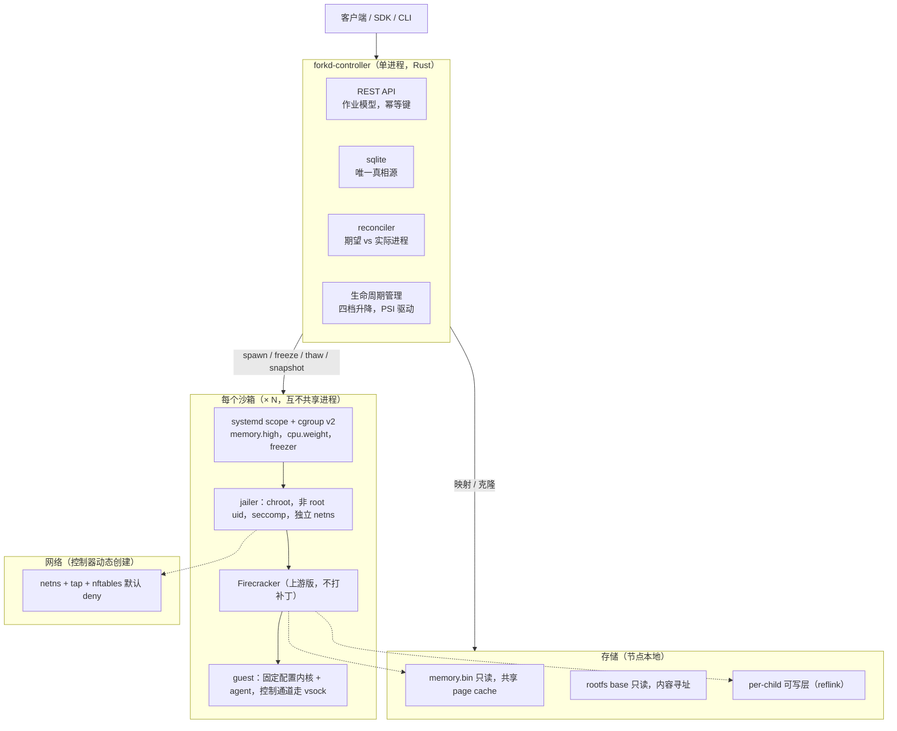
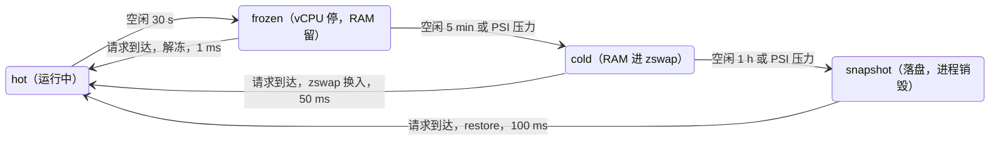

# forkd v0.6 架构 RFC

2026-10-22 · 状态：草案，待讨论 · 协作版本见 https://claude.ai/artifact/16AJtoKPSjvjTK9gobRFrR

## 1. 背景与目标

v0.6 把 forkd 从"单机 fan-out 工具"改造成"可大量超卖的沙箱平台"：空闲沙箱不占 CPU 和 RAM，控制器重启不丢沙箱，磁盘和网络在每个子沙箱之间真正隔离。

**v0.5 做对了什么。** 后端用上游 Firecracker 而不是 fork VMM；所有子沙箱 `MAP_PRIVATE` 同一个 `memory.bin` inode，page cache 真共享；guest agent 空闲时阻塞在 accept 上，没有定时器；auth 常量时间比较、audit 日志 SIGHUP 轮转、hub pack 格式、薄 SDK。这些全部保留。

**v0.5 的问题。** 对照 TencentCloud/CubeSandbox 的审查，forkd 踩的是同一类坑，只是代码量小十倍、改得动：

- 控制器状态是内存 map 镜像到一个 JSON 文件，重启时 `kill_orphans` 杀光所有活着的 Firecracker，运行期无人看管（issue #301）。
- 所有子沙箱以 rw 打开同一个 rootfs，N 个 guest 内核写一个 ext4，静默损坏（issue #317）。
- 生命周期只有 running 和"快照落盘再 kill"，没有冻结在内存、没有回收到 zswap 的中间档。cgroup 只写 `memory.max`，超限即 OOM kill 整个 VM。
- netns 池由脚本预建，`10.43.0.$((i+1))` 过 254 即非法，所有子沙箱同 IP 同 MAC 挂一个 bridge，无 egress 策略，guest 能直接打到宿主机。
- live-fork 需要 Firecracker 三处私改加 `--no-seccomp`，每个子沙箱整份拷贝 memory.bin 且记在控制器的 cgroup 上，write-protect 快照存在一致性竞争。
- chain spawn 每次全量 SHA-256 并生成私有 assembled 文件，深度 3 时 spawn 1.6 秒，且同 chain 沙箱之间零共享。
- Firecracker 以 root 加 ambient `CAP_SYS_ADMIN` 运行，jailer 装了但没用；CI 从未启动过一台真 VM。

**目标。** 一台 2 核 4G 机器稳定承载 250 个沙箱（约 15 hot、60 frozen、200 cold），一千个空闲沙箱的宿主机 CPU 低于 1 核，frozen 恢复 P99 低于 1 毫秒，控制器重启零沙箱丢失。

**非目标。** 多节点调度、共享内核后端（gVisor）、E2B 完整兼容、live BRANCH 的 56 毫秒 pause 窗口。这些要么放到 v0.7，要么明确放弃。

## 2. 结论总览：保留、重做、砍掉

保留的是已经被验证正确的地基，重做的是与超卖目标直接冲突的四块，砍掉的是收益抵不过维护代价的部分。

| 模块 | 现状（v0.5） | 裁决 | 理由 |
| --- | --- | --- | --- |
| Firecracker 上游版为后端 | `forkd-vmm` 调用 Firecracker API | 保留 | 不 fork VMM 是正确路线，升级到上游最新稳定版 |
| File backend 内存共享 | 所有子沙箱 MAP_PRIVATE 同一 inode | 保留 | page cache 真共享，是 cold 档的基础 |
| guest agent | Python PID 1，空闲阻塞在 accept | 保留 | 无定时器，比 envd 干净；补 SIGCHLD 收尸和 stream 轮询改 epoll |
| auth / audit / TLS | 常量时间比较、SIGHUP 轮转 | 保留 | 做对了，补 remote addr 和 principal 字段 |
| hub / pack 格式与 SDK | tar.zst + manifest，薄客户端 | 保留 | 格式中立，SDK 只需对齐 API |
| 控制器状态模型 | 内存 map + 整文件重写 JSON，重启杀光 | 重做 | sqlite 真相源 + reconcile + 重启重新接管（第 5 节） |
| 生命周期 | 只有 running 和快照后 kill | 重做 | 新增 frozen / cold 两档，是 v0.6 的核心（第 4 节） |
| 进程隔离与 cgroup | root + ambient caps，只写 memory.max | 重做 | jailer + per-VM scope + memory.high / cpu.weight / freezer（第 6 节） |
| rootfs | 所有子沙箱 rw 共用一个 ext4 | 重做 | 只读 base + per-child 可写层（第 7 节） |
| 网络 | 脚本预建 netns 池，254 上限，无策略 | 重做 | 控制器动态建 netns + nftables 默认 deny（第 8 节） |
| chain 校验与 assembled 文件 | 每次 spawn 全量哈希、私有文件 | 重做 | 写入时哈希一次，assembled 按 chain head 缓存成共享 inode |
| CI | ubuntu-latest，KVM 测试全部 ignore | 重做 | 自托管 KVM runner，每个 PR 启动真 VM |
| live-fork（memfd + UFFD_WP） | 需 Firecracker 私改三处、--no-seccomp | 砍掉 | 零共享、cgroup 记错、wp 快照有竞争；回到原生 diff snapshot |
| vendored Firecracker fork | v1.12 加 5 个提交 | 砍掉 | 随 live-fork 一起删，回到上游二进制 |
| `forkd-uffd` crate 与 experiments/ | PoC 和 no-op stub | 砍掉 | 代码已无用途，历史在 git 里 |
| CLI 直连 Firecracker 路径 | fork / run / snapshot 绕过 daemon | 砍掉 | 两套控制面互相冲突，CLI 改为纯 daemon 客户端 |
| workspace 子系统 | 独立 spawn 路径，suspend 会丢数据 | 砍掉 | 其语义被四档生命周期覆盖，并入 sandbox 资源 |

## 3. 目标架构

控制器是唯一的常驻进程，它不持有任何 VM 的生命周期：每个沙箱是一个独立的 systemd scope 里的 jailer 加 Firecracker 进程树，控制器挂了它们照常跑，重启后按 sqlite 里的记录按 API socket 重新接管。与 v0.5 相比删掉的是：vendored Firecracker、`forkd-uffd`、CLI 直连路径、netns 预建脚本、workspace 子系统。

## 4. 生命周期四档

超卖的全部来源是"没在干活的沙箱不占 CPU 也不占 RAM"。每个沙箱在任一时刻处于四档之一，档位越冷成本越低、恢复越慢；调度器按档位计数做准入，而不是按分配配额。

| 档位 | 机制 | CPU | RAM | 恢复时延目标（P99） |
| --- | --- | --- | --- | --- |
| hot | 正常运行 | 实际用量，cpu.weight 超卖，cpu.max 硬顶 | 工作集，memory.high 软顶 | 0 |
| frozen | `PATCH /vm Paused` 停 vCPU，再 `cgroup.freeze=1` 冻整个进程树 | 0 | 工作集不变 | 1 ms |
| cold | 在 frozen 基础上写 `memory.reclaim`，匿名页进 zswap，memory.bin 干净页直接丢 | 0 | 接近 0（zswap 压缩后约 1/3 工作集） | 50 ms |
| snapshot | Firecracker diff snapshot 落盘，进程销毁 | 0 | 0 | 100 ms 本节点 |

**降档由两件事驱动。** 一是空闲时长：最后一次 agent 请求完成后（包括流式请求的仍在进行中，这是 Cube 和 v0.5 都做错的地方）超过 `idle_to_frozen`（默认 30 s）、`frozen_to_cold`（默认 5 min）、`cold_to_snapshot`（默认 1 h）。二是节点压力：`/proc/pressure/memory` 的 some avg10 超过阈值时，生命周期管理器按"最久未活跃优先"把 frozen 压成 cold，再把 cold 压成 snapshot，直到压力回落。降档是异步后台任务，跑在 SCHED_IDLE，不和 hot 沙箱抢 CPU。

**升档由请求到达触发。** API 收到面向某沙箱的 exec / eval / 端口流量时，先把它升到 hot 再转发。frozen 到 hot 是解冻加 `PATCH /vm Resumed`；cold 到 hot 同样操作，缺页由 zswap 换入，不需要任何显式步骤；snapshot 到 hot 是一次 restore。升档要限流：同一秒内允许的 cold 到 hot 数量由宿主机核数决定，超出的排队，避免两百个冷沙箱同时被唤醒打爆 2 核。

**长时间冻结的两个细节。** 解冻前控制器通过 agent 做一次对时，并在 Firecracker 层通知 guest 被暂停过（`KVM_KVMCLOCK_CTRL`，上游 Paused 路径已处理），避免 guest 软锁定和 RCU stall 告警；guest 内开着的 TCP 连接在冻结期间会被对端超时，这是接受的行为，文档要写明。

降档只能逐级，升档总是一步到 hot。kill 从任何档位直接删除，snapshot 档的沙箱删除时不恢复，只清文件。

## 5. 控制面与状态模型

改成"sqlite 是唯一真相源，进程是 reconcile 的输入"。控制器重启、崩溃、升级都不碰任何沙箱进程。

**状态存储。** `state.json` 换成 sqlite（WAL 模式），三张表：`sandboxes`（id、tag、档位、期望档位、scope 名、API socket 路径、netns、可写层路径、最后活跃时间、pid + 启动时间、boot id）、`snapshots`（tag、parent_tag、内容哈希、状态）、`jobs`（长操作）。每次变更是一个事务，不再整文件重写，不再在全局锁里做 I/O。

**Reconcile 循环。** 一个后台任务每 5 秒做一次，外加每次写入后立即触发一次：读 sqlite 里的期望状态，读实际状态（systemd scope 是否存在、Firecracker API socket 是否应答、cgroup.freeze 值、memory.current），差异就是工作项。进程死了而数据库说 hot，标记为 `failed` 并清理 scope、netns、可写层；scope 存在而数据库没有记录，按 scope 名里的 boot id 判断是本机本次启动的孤儿才杀。这把 v0.5 里散在 `reconcile()`、`kill_orphans()`、`warn_orphan_firecrackers()` 里的三套逻辑合成一套。

**重启重新接管。** 启动时不杀任何进程。对每条 `sandboxes` 记录，连接其 API socket，`GET /vm` 拿到 Firecracker 自己报的状态，写回数据库。这就是为什么 VM 必须在自己的 systemd scope 里：它们不在控制器的 cgroup 下，`KillMode=control-group` 不会连带杀掉它们。控制器本身不再持有 `Child` 句柄，用 pidfd 观察退出事件。

**API 作业模型。** 任何可能超过 1 秒的操作（spawn n > 10、snapshot、compact、cold 到 hot 的批量唤醒）返回 202 和 `job_id`，`GET /v1/jobs/{id}` 查进度，每个子项独立成败，不再 all-or-nothing。`POST` 接受 `Idempotency-Key` 头，重试不产生重复沙箱。错误体带稳定的 `code` 字段，删掉所有按错误字符串判断重试的代码。资源收敛为 `snapshots`、`sandboxes`、`jobs` 三个，`workspaces` 并入 `sandboxes`（一个带 `name` 和 `persist: true` 的沙箱）。

**并发模型。** 控制器里不再有 `live_vms` 这样的全局锁。每个沙箱一把小锁，所有阻塞 I/O（哈希、拷贝、remove_dir_all、进程等待）走 `spawn_blocking`，并且有超时。

## 6. 隔离与进程模型

每个沙箱是一条 `systemd scope → jailer → firecracker` 进程链，以非 root 身份跑在自己的 chroot、netns 和 cgroup 里。v0.5 装了 jailer 但没用，Firecracker 以 root 加 ambient `CAP_SYS_ADMIN` 运行，这是和 CubeSandbox 同样的错误。

**启动链。** 控制器用 `systemd-run --scope --unit=sb-<id>` 起 jailer，jailer 参数：`--uid/--gid` 为每沙箱独立的高号 uid，`--chroot-base-dir` 下只有 memory.bin、vmstate、rootfs base、可写层和 vsock socket 的硬链接，`--netns` 指向控制器刚建的命名空间，`--cgroup-version 2`。控制器自身不需要 `CAP_SYS_ADMIN`，因为不再 setns 进 guest 网络去连 agent，改走 vsock。

**cgroup 写什么。** 每沙箱 scope 里写四项：`memory.high` 设为配额，超过触发回收而不是杀进程；`memory.max` 设为配额的 1.5 倍作为最后防线；`cpu.weight` 按档位设（hot 100，其它 1），`cpu.max` 只在用户指定硬顶时写；`pids.max` 默认 512。降档和升档只改 `cgroup.freeze`、`cpu.weight` 和写 `memory.reclaim`，不重建 cgroup。

**共享页的记账。** memory.bin 的干净页记在第一个缺页的沙箱的 cgroup 上，这是内核行为。解法是控制器在注册一个 tag 时用一个长期存在的 `tag-<name>` cgroup 预读一遍文件（`cat > /dev/null`），把共享页记到 tag 级，沙箱的 `memory.current` 就只包含它自己的脏页。这也是调度器能按"每沙箱真实增量"做准入的前提。

**宿主机内核参数。** `kvm.halt_poll_ns=0`，`transparent_hugepage=never`（对 guest 内存；2 MB 页会毁掉 CoW 共享），`zswap.enabled=1`，`zswap.compressor=lz4`，`zswap.max_pool_percent=50`，开 PSI。`setup-host.sh` 里的 KSM 和 1 GiB hugetlb 预留删掉。Firecracker 启动不再传 `track_dirty_pages: true`，只在用户请求 diff snapshot 前通过 `PATCH /vm` 打开。

**seccomp。** Firecracker 默认过滤器一直开着，没有任何路径需要 `--no-seccomp`。这是砍掉 live-fork 的直接收益。

## 7. 存储：rootfs 与快照链

rootfs 改成"只读 base 加 per-child 可写层"，快照链改成"写入时哈希一次、按 head 共享 assembled 文件"。两件事分别修 issue #317 和 chain spawn 的 1.6 秒。

**rootfs。** bake 时 base 以 `ext4_ro` 启动，快照里的 drive 是只读的。每个子沙箱 spawn 时控制器在 XFS 或 btrfs 上 `FICLONE` 一份 base 作为它的 `/dev/vdb`，实际上什么都不拷，spawn 延迟不变。guest 内 init 把 `/dev/vdb` 以 rw 挂在 `/` 上。不用 overlayfs，因为那需要 guest 内两个块设备加 overlay 逻辑，而宿主机侧 reflink 一步到位。宿主机不支持 reflink 时拒绝启动并报错，不默默退化成全拷贝（v0.5 的 `chain::reflink_copy` 就是这样退化的，而且 FICLONE 号还写错过）。`Snapshot` 元数据记录 drive 的只读标志和内容哈希。

**可写层的生命周期。** 跟沙箱走：snapshot 档保留，kill 时删除。`persist: true` 的沙箱允许把可写层导出为新的 base（这就是 v0.5 workspace 的全部语义）。

**memory.bin。** 保持 File backend 加 `MAP_PRIVATE`。Firecracker 启动时不开 dirty tracking。用户请求 diff snapshot 时才打开，拍完关掉。

**快照链。** 每个 snapshot 写入完成时计算一次 SHA-256，文件按 `<hash>` 存放，tag 是指向 hash 的指针。spawn 时不再哈希，只比较 inode、size、mtime 和记录值；要更强的完整性就开 fs-verity。chain head 的 assembled 文件第一次 spawn 时生成，存在 `<hash>/assembled.bin`，之后所有同 head 的沙箱映射同一个 inode，page cache 共享恢复。工作目录不再放 `/tmp`，因为 tmpfs 上既不能 reflink 也不该放 GB 级文件。

**删掉的 fallback。** v0.5 在上一次 branch 的内存文件丢失时会回退到源 tag 的 memory.bin 并只打一条 warning，产出的镜像是错的。v0.6 直接报错。

## 8. 网络

控制器在 spawn 时动态创建 netns，用 nftables 做 NAT 和默认 deny 的出站策略，不再有预建池、254 上限和 bridge。不重写 conntrack，内核处理分片、ICMP 和 PMTU。

**拓扑。** 每沙箱一个 netns `sb-<id>`，里面一个 tap 给 Firecracker，一对 veth 连回宿主机命名空间。宿主机侧不建 bridge，veth 的宿主机端直接分配 /30，每沙箱自己的点对点链路，互相天然不可达。guest 内 IP 和 MAC 保持固定（`10.42.0.2`，`AA:FC:00:00:00:01`），这是 v0.5 已经做对的：clone 不用重新配 IP，身份全在宿主机侧。

**地址分配。** 宿主机侧从 `100.64.0.0/10` 按 /30 切，容量 400 万，分配记在 sqlite 里，reconcile 回收死沙箱的段。

**策略。** 宿主机侧一张 nftables 表 `forkd`，forward 链默认 drop；每沙箱一个命名 set，允许的目标 CIDR 放进去，规则是 `iifname "veth-sb-*" ip daddr @allow-<id> accept`。固定前置一条 drop 覆盖 `10/8`、`172.16/12`、`192.168/16`、`169.254/16`、`100.64/10` 和宿主机自己的地址，用户策略打不开它。`allow_internet: true` 就是往 set 里放 `0.0.0.0/0`。出站 masquerade，MSS clamp 到 PMTU。IPv6 在 netns 里禁用，启动时断言。

**进站。** 端口暴露是每沙箱一条 DNAT，宿主机端口由控制器分配并记录。进站请求到达时先升档：这需要请求先经过控制器或一个轻量的 L4 代理。v0.6 先做前者，即只有走 API 的 exec / eval 触发升档；cold 沙箱的暴露端口返回连接拒绝，文档写明。

**控制通道。** agent 改走 vsock，控制器连 `<chroot>/v.sock` 再 `CONNECT 8888`。删掉 setns 线程、`CAP_SYS_ADMIN` 依赖和共享 tap 模式下本机任意用户都能连到 agent 的问题。

**实现。** 用 netlink（`rtnetlink` crate）和 `nftables` crate 直接说话，不 shell out 到 `ip` 和 `nft`。每沙箱 netns 创建约 2 ms，在 spawn 路径上不是瓶颈。

## 9. Guest 侧

guest 的目标是空闲时零唤醒、恢复后身份正确。agent 的大方向不变，内核配置从"下载 Firecracker CI 的 vmlinux"改成仓库内固定。

**内核。** 配置文件进仓库，CI 构建并按哈希发布。关键选项：`NO_HZ_FULL`、`HZ_100`、`VMGENID`、`VIRTIO_BALLOON` 加 `PAGE_REPORTING`、`HW_RANDOM_VIRTIO`、`RANDOM_TRUST_CPU`，关掉 `DEBUG_FS`、`KPROBES`、`MODULES`。启动参数加 `nohz_full=all`、`rcu_nocbs=all`。一个内核给所有模板，快照元数据记内核哈希，不匹配拒绝 restore。

**agent。** 保留 Python PID 1 的结构，但补三件事：SIGCHLD 处理和 `waitpid(-1)` 循环收尸（v0.5 的孤儿进程会堆成僵尸）；stream 会话的两个 0.5 秒 select 循环改成 epoll 阻塞，否则一个开着的 shell 每秒 4 次唤醒；监听从 TCP `0.0.0.0:8888` 换成 vsock 端口 8888。长期看这个 agent 应该换成 Rust 单二进制，但不在 v0.6 范围。

**恢复后的身份。** Firecracker 默认挂 vmgenid 设备，v0.6 在 `forkd doctor` 里验证 guest dmesg 出现 `vmgenid` 且 restore 后 `/proc/sys/kernel/random/boot_id` 变化。内核 CRNG 由 vmgenid 重播；用户态随机数（Python `random`、numpy、OpenSSL）在每个 clone 里是相同的，agent 在收到恢复通知时调用 `random.seed()` 和 `np.random.seed()` 重播自己的进程，其它进程的这个问题写进文档作为已知限制。恢复通知走 vsock 一条消息，换掉 v0.5 的对时 ping 循环，消息里带宿主机时间，agent `clock_settime` 一次。hostname 设为沙箱 ID。

**模板快照的时机。** bake 不再 sleep 固定 `boot_wait_secs`，而是等 agent 发来 `warmup_ready` 再拍。模板里不跑任何带定时器的常驻进程；recipe 的 warmup 进程（比如 Chromium）如果必须常驻，在 recipe README 里标注其空闲 CPU 成本。

## 10. 安全默认值与测试

默认值在开源后几乎改不动，v0.6 是最后一次能把它们定对的机会。原则：不配就是安全的，开放要显式写。

- **API：** token 文件不存在时拒绝启动，而不是默认开放；默认监听 Unix socket，TCP 要显式配。沙箱 ID 改为 128 位随机，删掉计数器。
- **宿主机路径：** `POST /v1/snapshots` 不再接受任意 `kernel` / `rootfs` 路径，只接受已注册的 tag 或 hub 引用。本地文件导入是 CLI 的事，走 `forkd import`。
- **能力：** 控制器 systemd 单元只要 `CAP_NET_ADMIN`（建 netns 和 nftables）和 `CAP_SYS_RESOURCE`（cgroup），不要 `CAP_SYS_ADMIN`。Firecracker 由 jailer 降权。
- **MCP：** 所有拼进 guest shell 的参数走 `shlex.quote`，`wait_for_text` 的 path 注入直接修。
- **网络：** 出站默认 deny，`allow_internet` 默认 false。
- **audit：** 补 remote addr 和 token 指纹，401 也记。

**CI 必须启动真 VM。** 一台自托管 KVM runner（裸金属或开了嵌套的云主机），每个 PR 跑：spawn 1 和 spawn 100、四档升降各一次、控制器 kill -9 后重启且 100 个沙箱全部存活、两个子沙箱写同一路径互不影响、netns 里 ping 宿主机被拒绝。`#[ignore]` 的 KVM 测试全部解除 ignore，在这台 runner 上跑。`cargo test` 仍在 GitHub 托管 runner 跑单元测试。没有 KVM runner 就不发版。

## 11. 从 v0.5 迁移与改名

v0.6 是架构重做但保留名字，改名放到 1.0 作为唯一一次兼容性 break。两件事分开做，否则用户分不清哪些是改名带来的、哪些是架构带来的。

**v0.6 兼容性。** `/v1/sandboxes`、`/v1/snapshots` 请求体保持可用，新增字段（`tier`、`idle_policy`）有默认值。删掉的接口：`/v1/workspaces/*`（改用带 `name` 的沙箱）、branch 的 `mode: "live"` 和 `wait`、`live_fork` 参数。返回 410 并在错误体里给出替代调用。hub 上已发布的 9 个快照继续可用：它们的 rootfs 是 rw 烤的，控制器读到无只读标志的旧快照时自动用 reflink 可写层包一层，行为和新快照一致。

**状态迁移。** 启动时发现 `state.json` 就导入 sqlite 然后改名为 `.imported`。旧记录里的 pid 不被信任，按 reconcile 规则处理。

**改名的成本。** 仓库里 3386 处引用、227 个文件。不疼的：API 路径是 `/v1` 中立的。疼的：烤进每个已发布快照里的 `/forkd-init.sh`、`/forkd-agent.py`、`/etc/forkd-recipe.env`，以及 PyPI `forkd`、npm `@deeplethe/forkd`、`FORKD_URL` / `FORKD_TOKEN` 环境变量、`/var/lib/forkd` 等路径。

**改名的做法（1.0）。** guest 内路径新旧并存一个大版本，kernel cmdline 的 `init=` 由快照元数据决定；环境变量新名优先、旧名警告；PyPI 和 npm 旧包发最后一版做转发。名字本身不在本 RFC 范围。

## 12. 里程碑 M0 验收指标

M0 只回答一个问题：在一台 2 核 4 GB 的机器上，这套设计能不能把 1000 个沙箱的空闲成本压到接近零。所有数字在同一台机器、同一个模板（`python-numpy`）上测，脚本进 `bench/m0/`，结果进 README。达不到就不进 M1。

| 指标 | 验收值 | 测法 |
| --- | --- | --- |
| hot 档每沙箱增量 RAM | ≤ 20 MB | 沙箱 cgroup 的 `memory.current` 减去 tag cgroup 已记的共享页，跑完一次 `eval` 后测，100 个取中位数 |
| cold 档每沙箱增量 RAM | ≤ 6 MB | 同上，降到 cold 后 30 秒测，含 zswap 池占用分摊 |
| 1000 个 frozen/cold 沙箱的宿主机空闲 CPU | ≤ 3%（两核合计） | `/proc/stat` 60 秒窗口，扣除基线（零沙箱时的宿主机 CPU） |
| 100 个 hot 空闲沙箱的宿主机 CPU | ≤ 5% | 同上；这条验证 guest 内核配置和 halt polling |
| frozen 到 hot 恢复延迟 | P99 ≤ 2 ms | 解冻到 agent 回应 `ping` |
| cold 到 hot 恢复延迟 | P99 ≤ 100 ms | 同上，单个沙箱被唤醒且其它 999 个保持 cold |
| snapshot 到 hot 恢复延迟 | P99 ≤ 150 ms | 同上，page cache 热 |
| 并发唤醒 | 50 个 cold 同时唤醒，P99 ≤ 2 s，无失败 | 验证升档限流 |
| 控制器 kill -9 后重启 | 1000 个沙箱 0 丢失，重新接管完成 ≤ 10 s | 重启后对每个沙箱 `ping` |
| 磁盘隔离 | 100 个沙箱并发写同一路径，每个读回自己的内容 | 对应 issue #317 |
| 网络隔离 | 沙箱内 ping 宿主机、邻居沙箱、169.254.169.254 全部失败；允许的域名可达 | 默认策略下 |
| spawn 延迟不退化 | 单个 spawn P50 ≤ v0.5 的 59 ms 加 20% | reflink 可写层和动态 netns 的代价上限 |
| chain 深度 3 的 spawn | P50 ≤ 100 ms（v0.5 是 1668 ms） | 验证内容寻址和共享 assembled |

两个数字有意放宽：hot 档 20 MB 而不是 10 MB，因为 agent 还是 Python；cold 档 100 ms 而不是 50 ms，因为 2 核机器上 zswap 解压会和其它事排队。M0 之后按实测收紧。

## 13. 风险与未决问题

最大的技术风险是 cold 档：对一个被冻结的 KVM 进程写 `memory.reclaim`，内核能把它的匿名页换出，但没有人在生产上这么对 microVM 做过，其它风险都有先例。

| 风险 | 影响 | 应对 |
| --- | --- | --- |
| `memory.reclaim` 对 KVM guest 内存效果不达预期（比如 KVM 锁页、EPT 映射阻止换出） | cold 档不成立，密度回到 frozen 档水平 | M0 第一周做一个 50 行的 PoC：冻结一个 Firecracker，写 reclaim，看 memory.current 和 zswap 计数。不成就改用 balloon 让 guest 自己交页 |
| 长时间冻结后 guest 时钟和 RCU 告警 | 恢复后内核日志刷屏，极端情况 panic | 验证 Firecracker Paused 路径的 kvmclock 处理；冻结超过阈值（比如 1 h）强制降到 snapshot |
| zswap 压缩比比预期差 | cold 档每沙箱 RAM 翻倍 | 测 python-numpy 和 playwright 两个模板，写进 M0 报告 |
| reflink 要求 XFS 或 btrfs | ext4 宿主机装不上 | `forkd doctor` 明确报错；文档给 loop 文件建 XFS 的做法，但不自动做 |
| 进站流量唤醒需要代理层 | 暂停的 web 服务收到请求时连接被拒 | v0.6 接受此限制，v0.7 加 L4 代理 |
| Python agent 的内存和启动成本 | hot 档压不到 10 MB | v0.7 换 Rust agent |
| 删掉 live-fork 引起现有用户反对 | README 头条卖点没了 | 把卖点换成密度和重启不丢沙箱；在 v0.6 release note 里给出 56 ms 对 200 ms 的完整权衡 |

**未决问题，要在讨论里定：**

- [ ] cold 档是否需要 balloon 配合：先让 guest 释放自己的 page cache，再写 reclaim，还是只靠宿主机侧。
- [ ] 升档是否允许 cold 直接到 frozen（预热但不跑），还是只有 hot 一个目标。
- [ ] 多租户模型放哪个版本：v0.6 仍是单 token，但 sqlite 表里预留 `owner` 列。
- [ ] gVisor 后端的接口边界：v0.6 是否就把 `Backend` trait 定下来，即使只有一个实现。
- [ ] M0 的测试机：裸金属还是开了嵌套的云主机。嵌套下恢复延迟指标要放宽一倍。

## 14. 市场参照

现有产品都在两极：要么一直跑着靠 TTL 回收，要么空闲就快照落盘销毁。没有人对 microVM 做"冻结在内存加主动回收"的中间档，这是 v0.6 的差异化。以下为 2026-10-22 检索，数字除 DSec 外均为厂商自述。

| 产品 | 底层 | 空闲策略 | 公开数字 |
| --- | --- | --- | --- |
| [DeepSeek DSec](https://arxiv.org/html/2609.22978v1) | Firecracker | 一直跑，TTL 回收，RL 抢占时才快照杀掉 | 800 microVM/节点；约 90% 沙箱平均 CPU ≤ 5% 申请量；pmem+DAX 峰值内存降 40.2%，DAMON+FPR 时间积分内存降 21.2%（论文） |
| [AWS Lambda MicroVMs](https://docs.aws.amazon.com/lambda/latest/microvm-api/API_IdlePolicy.html) | Firecracker | IdlePolicy 自动 suspend 到快照再 terminate | 按秒计 vCPU/内存加快照存储 |
| [Blaxel](https://blaxel.ai/platform/sandboxes) | microVM | 15 s 无活动拍快照，standby 不计费 | 恢复约 25 ms |
| [PandaStack](https://www.pandastack.ai/blog/overcommit-microvm-density/) | Firecracker，核心开源 | 空闲即销毁，下次从快照恢复，uffd 按 4 MiB 块懒取 | 恢复 p50 179 ms |
| [Fly.io Sprites](https://fly.io/sprites/checkpoint-restore/) | Firecracker | 空闲休眠，块设备级 CoW checkpoint | 约 1 s |
| [Google Cloud Run gen1](https://docs.cloud.google.com/run/docs/configuring/cpu-allocation) | gVisor | 请求之间 CPU 节流到近零，实例留在内存 | 即 frozen 档的容器版量产先例 |
| [Unikraft Cloud](https://unikraft.com/blog/scale-to-zero) | unikernel | 初始化完拍快照再 scale-to-zero | 自称 < 10 ms，单机数千到 10 万 |

DSec 验证了超卖的统计前提（绝大多数沙箱绝大多数时间是空闲的），也给出了内存三板斧的实测，但它对暂停容器用了 `memory.reclaim`，对 microVM 仍是快照加杀进程。它的 pmem + DAX rootfs 值得在 v0.7 评估：guest 跳过自己的 page cache 直接共享宿主机那份，Cube 也这么做。
