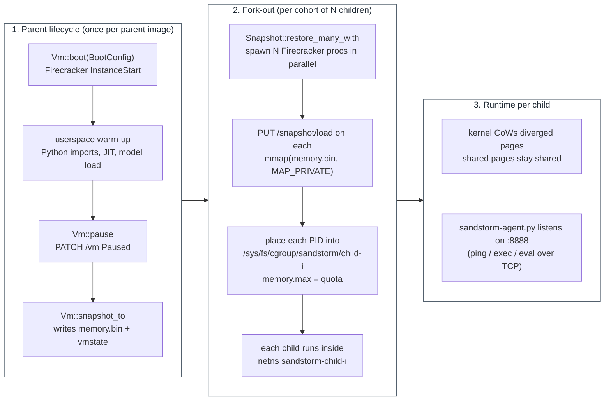

# Design

This document describes how sandstorm implements fork-on-write for
Firecracker microVMs and the constraints that drove the design.

## Overview



The kernel does the hard part (CoW page management). sandstorm's job is
correctness, isolation, and orchestration.

## Runtime: Firecracker

sandstorm builds on Firecracker rather than a container runtime or gVisor
because:

- **Snapshot/restore is first-class.** Firecracker's `/snapshot/load`
  with `MEMORY_LOAD_PRIVATE` is the exact primitive we need.
- **KVM-backed.** Each child gets a hardware isolation boundary, not
  a syscall filter or namespace.
- **Small.** ~5 MiB of resident memory per VM process before any
  guest state.
- **Stable API.** Rust ecosystem, well-trodden by AWS Lambda.

sandstorm uses upstream Firecracker — no vendored fork.

## Component layout

```
crates/
  sandstorm-vmm          Firecracker wrapper. BootConfig, Vm, Snapshot,
                     ForkOpts, cgroup helpers, network namespace
                     plumbing, raw HTTP/1.1 over Unix socket.
  sandstorm-cli          `sandstorm` binary. CLI surface: snapshot, fork,
                     run, exec, eval, ping.
  sandstorm-controller   `sandstorm-controller serve`. REST API, persistent
                     registry, audit log, /metrics, bearer-token
                     auth, graceful shutdown.
rootfs-init/
  sandstorm-init.sh      PID 1 inside the guest. Mounts pseudo-fs, fixes
                     DNS, launches the agent.
  sandstorm-agent.py     TCP server on :8888 (ping / exec / eval).
sdk/python/          E2B-compatible Python SDK.
```

## Hard problems and how sandstorm addresses them

### 1. Memory image backing

Putting `memory.bin` on tmpfs invites OOM kill. Slow disk kills
restore latency. sandstorm writes the image to ext4 by default and relies
on the page cache; on hosts with hugepages provisioned (per
`scripts/setup-host.sh`) the kernel transparently backs hot pages
with 2 MiB pages.

Future: explicit `memfd_create(MFD_HUGETLB)`-backed memory for
high-N fork-out, where the savings on page-table size dominate.

### 2. RNG and TSC

Children boot with the parent's RNG state and the parent's `tsc_offset`.
Both are cryptographically broken if exposed externally.

- **RNG**: Linux 5.20+ exposes `vmgenid`, a virtio-device-driven
  "generation counter" that the guest kernel watches; Firecracker
  bumps the counter on restore and the guest's CRNG re-seeds from
  /dev/hw_random automatically. sandstorm relies on this — no userspace
  daemon required.
- **TSC**: Firecracker assigns a fresh `tsc_offset` on each restore
  via its `--rdtsc` handling. This is enabled by default.

### 3. MAC / IP collisions

All children inherit the parent snapshot's MAC and guest IP. Without
network isolation they would collide on the host bridge.

sandstorm places each child in its own pre-provisioned network namespace
(`sandstorm-child-1` … `sandstorm-child-N`). Each namespace has:

- An independent tap (same name, same IP — different network stack).
- A `veth` pair into a shared `sandstorm-br0` bridge for outbound NAT.
- SNAT on egress so the bridge can reverse-route replies.

See `scripts/netns-setup.sh` for the exact iptables rules.

### 4. Block device CoW

Children need a writable rootfs but should share the base image.

Today sandstorm uses Firecracker's built-in read-write attachment with
overlayfs on the host. Each child gets a fresh upper-dir, lower dir
is the shared rootfs. Writes are per-child; nothing persists
post-exit.

Future: `dm-thin` for production density beyond a few hundred
concurrent children.

### 5. KSM aggressiveness

Default KSM (`kernel same-page merging`) is too lazy — minutes to
reach steady-state sharing. `scripts/setup-host.sh` tunes
`pages_to_scan` and `sleep_millisecs` for sandstorm's workload. With CoW
mmap, KSM is a backstop for divergent-but-similar pages; it doesn't
need to do the heavy lifting.

### 6. OOM cascades

If the host hits memory pressure and the OOM killer takes the parent
process, every child loses its backing pages.

sandstorm nudges each child's `oom_score_adj` up by +500 so the kernel
picks a runaway child first. With per-child `memory.max` set via
cgroup v2, runaway children are bounded before they push the host
into global pressure.

### 7. Per-child resource quotas

sandstorm creates one cgroup v2 leaf per child under
`/sys/fs/cgroup/sandstorm/child-N/` and writes the Firecracker PID to
`cgroup.procs`. Today only `memory.max` is wired into `ForkOpts`;
cpu.max / io.max / pids.max land before 1.0.

### 8. Scheduling affinity

Children must land on the same host as their parent (otherwise CoW
becomes copy-everything across the wire). v0.1 is single-host only;
multi-host scheduling is a v1.x problem and will require either a
warm parent on each scheduling target or a fast snapshot-replication
path.

## Authentication and audit

The controller daemon optionally requires a bearer token
(`--token-file`) on every request except `/healthz`. The check uses
length-aware constant-time comparison to avoid trivial timing oracles.

Every request is appended to a JSON-Lines audit log
(`/var/log/sandstorm/audit.log` by default): RFC3339 timestamp, method,
path, status, latency in microseconds, user-agent. Log rotation is
out of process (`logrotate`, `vector`, the journal).

## Related work

The sandbox-runtime space has been growing fast. sandstorm's contribution
is the fork-from-warm primitive on a full Linux microVM, with an
open-source operator surface (REST + auth + TLS + audit + metrics).
This section sketches how that compares to the projects most worth
benchmarking against.

### Tencent CubeSandbox

[CubeSandbox](https://github.com/TencentCloud/CubeSandbox) is the
closest open-source project to sandstorm in primitive choice: RustVMM-
based microVMs, KVM isolation, Apache 2.0. The published P95 cold-
start is "**<60 ms**" with per-instance memory overhead below 5 MiB,
which beats sandstorm's pure cold-boot path (sandstorm's snapshot fork wins
on the fan-out workload because it skips guest userspace warm-up,
not because the VM boots faster). CubeSandbox's roadmap mentions
"event-level snapshot rollback" with "high-frequency snapshot
rollback at millisecond granularity, enabling rapid fork-based
exploration environments from any saved state" — when that lands,
the two projects will overlap meaningfully. Until then sandstorm's
distinct value is that fork-from-warm exists today.

### Daytona

[Daytona](https://github.com/daytonaio/daytona) is OCI-workspace
oriented (Docker-compatible images, per-workspace kernel claim).
They advertise "**<90 ms** spinning up... from code to execution"
and a stateful-snapshot model for resume. There is no fork-from-warm
primitive — each workspace is its own resource. License is
**AGPL-3.0**, which is a meaningful difference for commercial users
embedding the runtime in proprietary services. Daytona's polish at
the workspace + agent-protocol layer is well ahead of sandstorm; the
projects target different shapes of workload.

### Alibaba OpenSandbox

[OpenSandbox](https://github.com/alibaba/OpenSandbox) is best thought
of as an **abstraction layer** over Docker / Kubernetes / gVisor /
Kata / Firecracker. It exposes a unified ingress gateway, per-sandbox
egress policy, and multi-language SDKs (Python, Java, JS, .NET, Go).
Apache 2.0, actively maintained. OpenSandbox does not itself implement
fork-from-warm; if you want that on top of OpenSandbox, you'd plug a
runtime that supports it. Conceptually sandstorm could be slotted in as
such a runtime in a future integration.

### BoxLite

[BoxLite](https://github.com/boxlite-ai/boxlite) bills itself as
"the SQLite of sandbox" — an embeddable microVM runtime with no
daemon, designed to scale from a laptop to the cloud without
changing primitives. Each Box runs an OCI container inside a
hardware-isolated VM (KVM on Linux, Hypervisor.framework on macOS),
with seccomp on the host side and `allow_net` for egress policy per
Box. Apache 2.0, primarily Rust + TypeScript + Go.

The interesting contrast with sandstorm is the **stateful Box model**.
BoxLite Boxes persist packages and files across stop/restart cycles:
you `apt install` once and that survives the next boot. sandstorm's
parent snapshot does something superficially similar — the parent's
RAM survives — but the semantics differ:

- BoxLite optimises for **one long-lived sandbox per workload**:
  start it, fill it with state, suspend, resume later, never rebuild.
- sandstorm optimises for **N short-lived children per parent**: the
  parent is the template, every child gets a fresh CoW divergence,
  children die freely.

Both designs avoid re-paying setup cost. They're complementary, not
competing — BoxLite is the right call when each agent owns a
persistent workspace; sandstorm is the right call when you fan out from
a warmed template. BoxLite's cross-platform support (macOS via
Hypervisor.framework) is a real differentiator sandstorm doesn't try to
match — sandstorm is Linux+KVM only and unlikely to add macOS support
because the snapshot-fork primitive depends on the host kernel's
CoW semantics on `mmap(MAP_PRIVATE)`.

### E2B

[E2B](https://github.com/e2b-dev/E2B) ships an open-source self-host
path (Apache 2.0) and a managed service. The OSS infra repo uses
Firecracker under the hood; specific spawn-time numbers are mostly
quoted from the managed product. There is no fork-from-warm primitive
in the open repo. sandstorm's Python SDK is **E2B wire-compatible at the
`Sandbox` class level** so existing E2B agents can switch by import
alone, with `sandbox.eval(...)` as the sandstorm-only extra that uses the
warmed-PID-1 interpreter.

### Modal

Modal is the only production system known to expose a fork-from-warm
primitive ("Modal Sandbox", proprietary). They are not open source;
sandstorm is the open-source analogue of that primitive specifically.
Pricing, scheduling, and the full developer-platform layer remain
their differentiator.

### Firecracker, Docker, gVisor

These are runtimes, not full sandbox products. sandstorm builds on
Firecracker directly. Docker (runc) and gVisor (runsc) are in our
benchmark chart as honest reference points: they cold-boot every
sandbox and pay the `import numpy` cost N times for an N-sandbox
fan-out.

## What sandstorm does not do

- Replace Modal or E2B as a SaaS.
- Beat function-level snapshot runtimes (single-vCPU, serial I/O) on
  raw spawn time; sandstorm targets full Linux microVMs with networking
  and multi-vCPU.
- Support arbitrary guest OSes. v0.1 targets Linux x86-64.

## Stability

API versioning: the REST surface is at `/v1`. Breaking changes move
to `/v2` and the previous major is supported for one minor release
after the new one ships. On-disk snapshot format is currently tied
to Firecracker's `Full` snapshot version; we do not promise forward
compatibility across sandstorm versions until 1.0.
