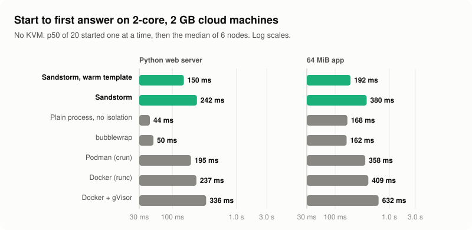

<div align="center">

<picture>
  <source media="(prefers-color-scheme: dark)" srcset="docs/logo-dark.svg">
  
</picture>

</div>

<br/>

<div align="center">

[工作原理](#工作原理) · [实测数据](#实测数据) · [快速开始](#快速开始) · [状态](#状态)

[](https://github.com/deeplethe/sandstorm/actions)
[](LICENSE)
[](https://www.rust-lang.org)
[](https://deeplethe.com)
[![gVisor](https://img.shields.io/badge/GVISOR-2D333B?style=flat-square&logo=data:image/svg%2bxml;base64,PHN2ZyB4bWxucz0iaHR0cDovL3d3dy53My5vcmcvMjAwMC9zdmciIHdpZHRoPSIxNzUuMzUiIGhlaWdodD0iMTkzLjIwIiB2aWV3Qm94PSIwIDAgMTc1LjM1IDE5My4yMCIgPjxnIHRyYW5zZm9ybT0ibWF0cml4KDEuMzMzMzMzMywwLDAsLTEuMzMzMzMzMywtNjE0LjQ1LDYzOC45NikiPjxnIHRyYW5zZm9ybT0idHJhbnNsYXRlKDU0OC4yNCwzNjMuMjQpIj48cGF0aCBkPSJtIDAsMCBjIDE2LjY1LDIxLjEyIDIyLjY5LDQ0LjQzIDE4LjMyLDcwLjk5IDMuMDYsMCA1Ljc0LC0wLjAyIDguNDEsMC4wMCAyLjIyLDAuMDIgNC40NCwwLjEwIDYuNjYsMC4xNyA0Ljc5LDAuMTUgNC44MSwwLjE2IDUuODgsLTQuNTggMy4xNCwtMTQuMDUgMi4xOCwtMjguMDkgLTAuMTcsLTQyLjExIC0wLjI1LC0xLjQ5IC0wLjcsLTIuOTUgLTAuODYsLTQuNDUgQyAzNy4wNSw5LjA4IDMwLjA4LDMuNjQgMjAuMTYsMS4wOSAxMy43OCwtMC41NCA3LjMyLC0wLjgyIDAsMCIgc3R5bGU9ImZpbGw6I2ZmZmZmZiIgLz48L2c%2BPGcgdHJhbnNmb3JtPSJ0cmFuc2xhdGUoNTQ0LjY4LDM5Ni4xNykiPjxwYXRoIGQ9Ik0gMCwwIEMgMCwyLjU5IC0zLjQ1LDQuMzIgLTMuNDUsNC4zMiAtMC44Niw1LjE4IDAsOC42NCAwLDguNjQgMCw4LjY0IDAuODYsNS4xOCAzLjQ1LDQuMzIgMy40NSw0LjMyIDAsMi41OSAwLDAgbSAtMTcuMDksNi40NSBjIDAsNi43NCAtOC45OCwxMS4yMyAtOC45OCwxMS4yMyA2Ljc0LDIuMjQgOC45OCwxMS4yMyA4Ljk4LDExLjIzIDAsMCAyLjI0LC04Ljk5IDguOTksLTExLjIzIDAsMCAtOC45OSwtNC40OSAtOC45OSwtMTEuMjMiIHN0eWxlPSJmaWxsOiNmZmZmZmYiIC8%2BPC9nPjxnIHRyYW5zZm9ybT0idHJhbnNsYXRlKDQ4NS4wOCw0MjkuNzkpIj48cGF0aCBkPSJtIDAsMCBjIDAsMCAtMi4yMSwzLjM1IC05LjczLDIuMDUgMCwwIDUuOTgsMjguNzMgMzYuMjksMzguODAgQyAyNi41Niw0MC44NiAtMi44MiwyNC4yNyAwLDAgTSAwLjU4LC0zMy4yMCAwLjU4LC0zMy4yMSBjIC0xLjI5LC0yLjAyIC0yLjgyLC0zLjU3IC00LjUzLC00LjYxIC0xLjUxLC0wLjkzIC0zLjE3LC0xLjQyIC00Ljc0LC0xLjQyIC0wLjUyLDAgLTEuMDQsMC4wNSAtMS41MywwLjE3IGwgLTIuMjAsMC41MCAyLjE4LDAuNjAgYyAxLjYzLDAuNDUgMy4wNiwxLjM0IDQuMjUsMi42NiAxLjAxLDEuMTAgMS44NSwyLjQ4IDIuNTcsNC4yMSAxLjE3LDIuODIgMS43OCw2LjE2IDEuODEsOS45MyAtMC4wNCwzLjcxIC0wLjY4LDcuMDUgLTEuODgsOS45MCAtMC43MCwxLjY1IC0xLjU4LDMuMDUgLTIuNjIsNC4xNiAtMS4yMiwxLjMxIC0yLjY3LDIuMTcgLTQuMjksMi41NyBsIC0yLjE4LDAuNTMgMi4xNywwLjU3IGMgMC40OCwwLjEyIDAuOTksMC4xOSAxLjUzLDAuMjAgaCAwLjAzIGwgMS42OCwtMC4xNSBjIDEuMDQsLTAuMjAgMi4xMCwtMC42MSAzLjA2LC0xLjE4IDEuNzUsLTEuMDMgMy4zMCwtMi41NiA0LjU5LC00LjU2IDIuMTUsLTMuMzcgMy4zMSwtNy41MyAzLjM1LC0xMi4wNCAtMC4wMiwtNC41NCAtMS4xNSwtOC43MSAtMy4yNywtMTIuMDYgbSAxMDEuOTQsNTEuMTcgYyAwLDAgLTAuMDcsMC4wNSAtMC4yMiwwLjEzIC0wLjU0LDAuMzIgLTEuMTEsMC42MCAtMS43MSwwLjgxIC0zLjA0LDEuMjQgLTkuODgsMy4xOCAtMjEuOTAsMi42MiAtMC4wMiwwIC0wLjA1LDAgLTAuMDgsLTAuMDAgQyA1Mi45MSwyMS4xMiAzMC4wMiwxMC45MiAzMC4wMiwxMC45MiBjIDAsMCAxLjQzLDEuNzYgMy40NSwzLjY5IDEwZS00LDAgMTBlLTQsMTBlLTQgMC4wMCwxMGUtNCAxLjA1LDAuOTcgMi4zNSwyLjA3IDMuOTEsMy4yMiAwLjA0LDAuMDMgMC4wOCwwLjA2IDAuMTIsMC4wOSA4LjcwLDYuMzggMjUuMzQsMTQuMTYgNTEuNjIsOS41NCAtMC45OCwxLjEyIC0yLjAwLDIuMTkgLTMuMDMsMy4yMSAtMS4xMSwwLjg4IC0yLjIzLDEuNjkgLTMuMzUsMi40NSAwLjAyLC0wLjAxIDAuMDMsLTAuMDIgMC4wNSwtMC4wMyAwLDAgLTE3LjAxLDE5LjQxIC00OC42OCwxNS44OSBDIDMwLjE5LDQ4LjYyIDI1Ljk4LDQ3Ljg2IDIxLjY2LDQ2LjU2IDIxLjY1LDQ2LjU2IDIxLjY0LDQ2LjU2IDIxLjY0LDQ2LjU2IEwgMjEuNjMsNDYuNTUgQyAxMS40OCw0My40OSAwLjY4LDM3LjM4IC04LjcxLDI1LjkxIC05LjI5LDI1LjE5IC05Ljg0LDI0LjQ3IC0xMC4zNywyMy43NyBjIC0wLjA2LC0wLjA5IC0wLjE0LC0wLjIwIC0wLjIyLC0wLjMwIC0xLjE4LC0xLjU4IC0yLjI3LC0zLjE0IC0zLjI3LC00LjY3IC0zLjI2LC01LjQyIC01LjYzLC0xMS42NiAtNi4zMSwtMTMuNTQgLTEwLjU4LC0zMi40MCAyLjU4LC01Ny41NSA1LjE0LC02MS45NiA4LjkzLC0xNS4xNSAyNC41NiwtMzIuMzUgNTAuNzcsLTM3LjMyIDAuMTksLTAuMDQgMC4zOCwtMC4xMCAwLjU4LC0wLjE0IDEuNzIsLTAuMzYgNC44NiwtMC45MiA4LjkwLC0xLjE5IDEuNTIsLTAuMDYgMy4wOCwtMC4wOSA0LjY5LC0wLjA2IDEuNTQsLTAuMDAgMi45OSwwLjAxIDQuMzMsMC4wNiAwLjM5LDAuMDIgMC43NCwwLjA0IDEuMDQsMC4wNCA1LjEwLDAuMjMgOC4yNywwLjc3IDguMjcsMC43NyAtMjYuNTQsMS4yOSAtMzkuODQsMTMuNDAgLTQ1LjY5LDIxLjE0IC0xLjMyLDEuNjQgLTIuNDYsMy40MiAtMy4zNyw1LjMxIC0wLjM2LDAuNzEgLTAuNTIsMS4xMSAtMC41MiwxLjExIDguNDUsLTcuMTggMjAuMjksLTEzLjM2IDIwLjI5LC0xMy4zNiAxMC42MSwtNC45OSAyMS43MywtNy40NSAzMy41MiwtNS44MyAwLDAgMjQuNjQsMi4yNiAzNC40NiwyNS4wOSAtMC40MiwwLjMyIC0wLjM2LDAuMjcgLTAuNzksMC42IC0wLjY1LC0wLjUyIC0xLjI5LC0xLjAyIC0xLjkyLC0xLjQ5IC0wLjk5LC0wLjY1IC0xLjk2LC0xLjM1IC0yLjkzLC0yLjA3IC01LjI2LC0zLjQ4IC05LjU2LC01LjEyIC0xMi4xMiwtNS44NyAtMTkuMzUsLTQuODggLTM3LjI3LC0xLjI1IC01Mi45MywxMi40NSAtNy4yNSw2LjM0IC0xMS43NSwxNC4zNSAtMTEuOTQsMjQuMjkgLTAuMTIsNi40NiAtMC4xOSwxMi45MyAtMC4xMywxOS40IDAuMDgsMTAuMTggNy4yNCwxNy45MiAxNy4zOSwxOS4yOCAyMC41NiwyLjc1IDQxLjIzLDMuNzEgNjEuOTQsNC4xOSAzLjE3LDAuMDcgNS45OCwwLjAzIDcuNDUsLTMuMzUgMC4wMiwtMC4wNSAwLjM2LDAuMDIgMC41NSwwLjAzIDEuNCw0LjQ2IC0wLjYxLDkuMjcgLTQuMjksMTEuNjIiIHN0eWxlPSJmaWxsOiNmZmZmZmYiIC8%2BPC9nPjwvZz48L3N2Zz4%3D)](https://gvisor.dev)
[![Firecracker](https://img.shields.io/badge/FIRECRACKER-2D333B?style=flat-square&logo=data:image/png;base64,iVBORw0KGgoAAAANSUhEUgAAACgAAAAoCAYAAACM%2FrhtAAAAAXNSR0IArs4c6QAAAHhlWElmTU0AKgAAAAgABAEaAAUAAAABAAAAPgEbAAUAAAABAAAARgEoAAMAAAABAAIAAIdpAAQAAAABAAAATgAAAAAAAABgAAAAAQAAAGAAAAABAAOgAQADAAAAAQABAACgAgAEAAAAAQAAACigAwAEAAAAAQAAACgAAAAApjS%2BXAAAAAlwSFlzAAAOxAAADsQBlSsOGwAAAWRpVFh0WE1MOmNvbS5hZG9iZS54bXAAAAAAADx4OnhtcG1ldGEgeG1sbnM6eD0iYWRvYmU6bnM6bWV0YS8iIHg6eG1wdGs9IlhNUCBDb3JlIDYuMC4wIj4KICAgPHJkZjpSREYgeG1sbnM6cmRmPSJodHRwOi8vd3d3LnczLm9yZy8xOTk5LzAyLzIyLXJkZi1zeW50YXgtbnMjIj4KICAgICAgPHJkZjpEZXNjcmlwdGlvbiByZGY6YWJvdXQ9IiIKICAgICAgICAgICAgeG1sbnM6eG1wPSJodHRwOi8vbnMuYWRvYmUuY29tL3hhcC8xLjAvIj4KICAgICAgICAgPHhtcDpDcmVhdG9yVG9vbD53d3cuaW5rc2NhcGUub3JnPC94bXA6Q3JlYXRvclRvb2w%2BCiAgICAgIDwvcmRmOkRlc2NyaXB0aW9uPgogICA8L3JkZjpSREY%2BCjwveDp4bXBtZXRhPgqyyWIhAAAJG0lEQVRYCaVYW2xcRxn%2B51x2z6693thu7boOCbawGzXFEShSUB%2Bg8MBFFaCqD3koRcADQqoUVIwQD5TygATiASHEQwVIXIqEqj6AUKWipmpIiQopIcJq08Yxie3Yydo4sXe9tnf37LnwfWOPvZvsrtfOL83OnjMz%2F3zn%2B29zjpJ7kHPnzmX6%2BvoeVkod8jyvP5FIHLJt%2B%2BOpVOo0rucsy5qG%2BrcxXtjvNs5%2BF8ZxbOfz%2BT%2Bur68%2FHgSBAJAAoACUpNPpE9QbhqHMzMy%2BirmfB8hwP3tZ%2B1nENQD3dGdn5%2BPZbFbAmgCobGxsSLValVKphPGCXJuZFdtxPjc5NfXl%2Fe6j9rNwcXGR5ryQTCYPkiUKwUVRpJmsVHzJr65KHIu4js37845tHR8eHl7c6377YhDmeg5%2BdpCmNQKzCgBLsbgmK4VNl1N4%2FAAPAPMf9P3q983cvfR7ZnBhYeEEgJzFJkn6GxsFoLWZl1fyorbu6YGtMduyKlEYfGJ0dPS8ud9OvycGGRhoP4LPJdHX6fd9X9bW1kRJ%2FX1O4lz4YjKM5MdnzpzZU2DuCWAulzsJ9j5ZLpfrwDEwKpWKjloy2Qgkxz0v%2BdjAwMGTdYt3uWgb4NTUVBec%2FXkGQq0QHH2RPZnaBMgZdzPJtbHEz1NXrY5W%2F9sGiKj9KgJjlECMEBgbgbGHn2mfpF%2Bqu%2FFJFXPS6dQI4uZrRsdufVsA%2BcQAcYp%2BRjAUpheTYthr9ixbrCgUK46QG6Ea%2FZ1CkEB%2Fql0W2wIIRp5CqhgmSxSCMUB5TVZpWkl60nX2ZTnw2u9EeWmxcK92HudSBywxBHN%2Fide7ya4AJyYmOqDkmwac9jGC2RLtVwBsUo539T%2BSfufvYsHbWGGAUGKFbdi2hLrgracmFhaou6XsrGoyDeXsJNh7iCwRhN60Zi43M6BVGIiT%2F584t26IXVoTy3XFrZYk%2B9afxb19U2K4AIVmps5ksbhrRLcEOD097cFEz9LHCMzFhkZoOt6PsKlKJHVytisbYhdvi%2BWjLxWR%2B1xxwLZdWhVVXsfSHeZDZoMwfpZ7GJ2N%2BpYAYb4n8aSPEAxPKkZ4TdNGMFsSJk29e05UMi1ufhEAlxEDCBIAog%2Bqrm4pfOopKfcfFhXtlEZaJJnyHqkEwZNGb6O%2BKcBLly4lAORbNKsBtw2M%2BUz7lpKuV16Q7hd%2FoDf3Jv8lCiaF12kTC9hl6rHxcAoWQKmrw6B1RPE496obqLloChCR9gUcAD5KJZRacJo93LervtgbebHBXPdvvycdb%2FxBYi%2BlK4mzuqRBWY4j3npevJUFBgYyz07qYdpCZfoI3OeLNZjq%2FjYEiBzFg8C4A%2BV3AjPXynbEXl%2FRPhcnU5I%2B%2F4rYhSWcr5IC2sTJXUNQIS9iXtebL8mBf%2FxJvOUbcLu7M7hS1jj3rEO2ddEQIPzuY2ysnwYQn5z%2Fw61Ka7sJcRdnRCFaET0Sp9ICXxDB%2BU84lpvSMxnZ3pW3xS3eksy1i2KFVQTXjqnJou26J8JQPdo2QDjwAlrJgDMmjWBS792z4lbWRRHE9feQYsAImN5uYCxGwuaYm7sqCfT20nVxV26KC3dI3Z6XCEuMqZmikA3CyI4bvrc0ZHBoaGgKoN5haiG4TeYsbPhfSV05L6mlGUQoCLt6ET80KQCaRrAAr4KyZH%2F9bcm8%2BJzA1uIWkB%2FLawA4Bw9QqCibNZ1BCLw3rDCcaptBPBVwRW9wMQFutlCc5RyCoiAdf%2Fm5ZH41Ls78Zc3WJnswLc1rGoBbAGUhQPgQCjXahQ%2B6lTVx8J9CkA5zaxy%2Ff%2BTIkWIjgE0PjwD1Onzwu2SPDT%2BimIALi2KBBevWdYkdZoed5MsNmGK2hWwaAXA7nxOHACWSAEk8gP9xNaz8bzPtzr5GQ%2F0Q3tIuIgXkEMkD8BBdShVMw0NAmL1f6PxIbPWLWl3hAVl1dFXSFQbuAwtVShtcdaHZ0qYAx8bGViYnJ%2F8JP3yCSmNlS5zpFTU8JtHcpMQoa1KtbAIlw%2FVE1u%2BnSY1lpfuwhOmsWEhLNuoxSyesVMQee2eQO8C0p%2BGPT2zv1vOASDEn8oGHJF6aA0CcD6tlBITfgk2wjtK31nG%2FlNI9YqWy4iDK7bgE13V4%2FLpw9OhRKGssTRnkdDD3Jt4%2FfARLgj5o9R2WOHcZ9RXBAMeJ11YAELmSTAKsIMdxnpYtRhWuK4kOKXY%2BALYj8fuGhEcOZggCBIuv4rLGcTeXm9%2BWAPGF4Eomk7kMZWM6WDqyEgCkc3NSVPY%2BnU4EpjYgySg8X0es2TOyHFnt6JcYJg37PyhB94BEjF6AQ64N0L9mwDTqG%2BZBM%2FH48eNMVmfpKzqh4gRSHnxYwmQHiEJN7YQ%2FdcFsXb0iuvWg75EY92MPZ1G09QMPCs7bEnXdJ9XRE6CKOTDQL%2FnQ%2Bf7y8vJ7Zr9GfUuAXIB0c9ocSqt%2BRXzHk9LoozhqYRBsxQkcDsAsgSqCzACkbt1SyfZLWRC5nd3iH30MOROg8WDUx4cme1skNMKm77U0MWdA0XmY4jZqc6%2BO5kpZYjh79OHPijeNGotTCyuHlfAAFg3mo8lpxkqoxM%2F2in%2FoGN5XUjqQtCWQFVjn8Z%2F%2B11JaJYfthThp%2FBW%2B%2BBkWdgo34WmZjp4oLqLOokJIGOGAqi0Sw%2B82cKfgdsmGS9YQAyZ4sJ7%2Bh6PcHA%2FDvb29q1ppk59dGeQ6AOEHyW2ADJiAKSZibuyH4w9KYFlRRzoVYa5TqQZSwWcQnx%2BR4BZ3Cs6aZPBvg4ODLcFx3a4%2ByEkw7e%2Fx3eV1KqbvGKHJAwAIYHbfrzgbpXIUIXq0r6JChIzqGiFz1IHscAEAf1gz1PRvWybmarDmzs%2FPfwU58TsogR%2BiDxEgRZt8M6%2FFeAskAFUAe5xD4aEDa%2FAQ%2Fjzm%2FhTfEn957NgxvkXtKm0DNJrm5uZ6sMk30J7Bpg%2FWAqVPAmAMAGoVHzApBIY5tzH%2FBQTbL1A1Foyudvo9AzRKUacHETjPgNmvA0Qvv3jxWAYTxvivyC4Y4xHqN7j%2FMxynps3avfT7Bmg2mZ2dHQZz4zDj03j7y5BFmLcM1l7CvZ%2BMjIy0TMRGT7P%2BngEaxTD9CILg02B0AAy%2BjO%2FRE2bsXvr%2FAx2ptl%2F0braeAAAAAElFTkSuQmCC)](https://firecracker-microvm.github.io)
[](README.md)

</div>

**一个有意超卖的沙箱集群。** agent 的沙箱大部分时间都闲着。Sandstorm 先把闲置的沙箱暂停，再把它 checkpoint 到磁盘；请求一到，马上恢复。所以一台机器能装下的沙箱，远多于它能同时跑着的数量。每个沙箱都是一个 [gVisor](https://gvisor.dev) 容器，有自己的网络命名空间。Sandstorm 跑在普通云主机上，不需要 KVM，也不需要嵌套虚拟化。在有 KVM 的机器上，沙箱也可以是一个 [Firecracker](https://firecracker-microvm.github.io) 微虚拟机（`--backend firecracker`），启动比我们测过的其他所有沙箱都快（[见下文](#在有-kvm-的机器上对比其他沙箱)）。

六台 2 核 2 GB 的云主机，全部常驻只能放 **286** 个 Python HTTP 服务；用 Sandstorm 放了 **20,000** 个。之后随机抽 1,200 个去请求，1,198 个都正常响应。

<div align="center">

<picture>
  <source media="(prefers-color-scheme: dark)" srcset="docs/assets/charts/fleet-overview-dark.svg">
  
</picture>

</div>

master 在 `/` 提供控制台：每个沙箱在哪一档、在各档之间流动多快、每个节点还剩多少内存。下图是模拟的 6 节点集群。

<p align="center">
<picture>
  <source media="(prefers-color-scheme: dark)" srcset="docs/assets/console-dark.webp">
  
</picture>
</p>

## 工作原理

每个沙箱处在四个档位之一。闲得越久降得越低，每次降一档；任何请求都让它直接回到 hot。

| 档位 | 状态 | 占内存 | 回到 hot |
|---|---|---|---|
| **hot** | 运行中 | 是 | — |
| **frozen** | 原地暂停（`cgroup.freeze`），冷页被压进 zswap | 部分 | 约 10 ms |
| **snapshot** | checkpoint 到节点本地盘，释放网络命名空间 | 否 | 约 0.2 s |
| **detached** | 只剩它的卷 | 否 | 冷启动 |

- **一个 master，多个节点。** master 把期望状态存在 SQLite 里，决定沙箱放在哪台机器。可以由 master 凭地址和配对码连上节点，也可以由 NAT 后面的节点主动连 master。
- **流量唤醒。** 请求先到沙箱所在节点上的网关，网关把沙箱唤醒，再转发请求。
- **节点会保护自己。** 内存不够时，节点会拒绝新任务，不会把自己撑爆，ssh 也一直能连上。
- **只有一个二进制。** `sandstormd` 既是 master，也是节点，还带 web 面板。

## 延迟和开销

开头总览图里另外三张图，先是右边两张：

- **唤醒。** 在节点本机上测，不经过网络。热的沙箱 3.8 ms 就有响应。冻结的沙箱，解冻只要 11 ms，其余时间主要花在把堆内存从 zswap 读回来，合计约 100 ms。已落盘的沙箱，64 MiB 的堆恢复约 230 ms。
- **有流量的时候。** 每个节点放 40 个沙箱，只装得下约 12 个同时醒着，少数几个沙箱拿走大部分请求。唤醒时内存不够，节点会先把最少被用到的沙箱落盘腾出位置；2 秒内起不来的唤醒直接拒绝，不排队。所以每个节点每秒 1、2、4、8 个请求时，被拒绝的只有 **1.1%、0.1%、0.2%、2.5%**，修复前是 13%、26%、32%、33%（三遍，共 40,500 个请求）。代价在长尾：要等恢复的请求，p99 在各个速率下都是 2 秒左右。超过节点的周转能力时——每节点 80 个、每秒 8 个请求——会拒绝 10.6%，p99 是 3.2 秒。
- **更重的沙箱。** 堆内存大的时候，一个沙箱的开销和同一个程序直接作为普通进程跑差不多：64 MiB 时每个节点 11 个对 10 个，256 MiB 时 4 个对 3 个，512 MiB 和 1 GiB 时两边都是 2 个和 1 个，因为节点会把闲置的页压进 zswap，而测试用的堆特别好压缩。堆小的时候，gVisor 自身的开销占大头，16 MiB 时是 19 个对 24 个，分档正是用来弥补这个差距的。从磁盘恢复的时间随堆增长：64 MiB 要 0.2 s，256 和 512 MiB 约 1 s，1 GiB 要 3.6 s。

## 同样的机器，不用 Sandstorm

<div align="center">

<picture>
  <source media="(prefers-color-scheme: dark)" srcset="docs/assets/charts/fleet-compare-dark.svg">
  
</picture>

</div>

同一个 Python HTTP 服务，同样六个节点，每种运行时都全部放在内存里，一直加到只剩 512 MiB，每个节点测两遍（[`baselines.py`](bench/fleet/baselines.py)）。同样是 gVisor 隔离，Sandstorm 全部常驻时比 Docker + gVisor 多放一半，因为它没有守护进程，也不需要每个容器一个 shim；闲置的分档落盘之后，比任何全部常驻的方式都多出两个数量级。

| 每节点，2 vCPU，1.9 GB | HTTP 服务常驻数 | 64 MiB 堆 |
|---|---:|---:|
| 普通进程 | 96 | 11 |
| bubblewrap | 94 | 11 |
| Podman (crun) | 88 | 12 |
| Docker (runc) | 60 | 10 |
| Docker + gVisor | 32 | 9 |
| **Sandstorm，全部常驻** | **48** | **13** |
| **Sandstorm，闲置的分档** | **3,333** | |

启动速度在同一类机器上测：6 台 2 核 2 GB 云主机（5 台 AMD EPYC 7K62，1 台 Intel Xeon 8255C），每种运行时一次启动一个，每 5 ms 请求一次直到它响应，测 20 次，再取 6 台 p50 的中位数（[`compare.py`](bench/baremetal/compare.py)、[`setup-gvisor.sh`](bench/baremetal/setup-gvisor.sh)）。Sandstorm 的时间包括 master 调度和节点建网络。

<div align="center">

<picture>
  <source media="(prefers-color-scheme: dark)" srcset="docs/assets/charts/fleet-start-dark.svg">
  
</picture>

</div>

| 启动到首次响应，p50 | web | 64 MiB 应用 |
|---|---:|---:|
| 裸进程 | 44 ms | 168 ms |
| bubblewrap | 50 ms | 162 ms |
| Podman（crun） | 195 ms | 358 ms |
| Docker（runc） | 237 ms | 409 ms |
| Docker + gVisor | 336 ms | 632 ms |
| **Sandstorm** | **242 ms** | **380 ms** |
| **Sandstorm，预热模板** | **150 ms** | **192 ms** |

隔离级别和 Docker + gVisor 一样，Sandstorm 启动 64 MiB 应用少用 40% 的时间，和不带 gVisor 的 Docker 差不多。预热模板恢复的是应用已经启动好的镜像，省掉了 Python 导入 numpy 和填充堆的时间，只比裸进程慢 25 ms 以内；它需要主动开启，因为所有沙箱都从同一份内存开始，模板得说明怎么重新播种随机数。每台节点的原始数据：[bench/baremetal/results/2026-10-30/fleet](bench/baremetal/results/2026-10-30/fleet)。

Podman 下的 CRIU checkpoint/restore 是标准工具里最接近落盘档位的做法：64 MiB 应用落盘 0.3 s，恢复到首次响应 0.24 s；Sandstorm 恢复同一个应用要 0.2 s。E2B、CubeSandbox、microsandbox 都基于 Firecracker，需要 KVM，这几台云主机没有；它们在下面一台有 KVM 的机器上测了，同类项目的对比见 [docs/COMPARISON.md](docs/COMPARISON.md)。

## 在有 KVM 的机器上，对比其他沙箱

<div align="center">

<picture>
  <source media="(prefers-color-scheme: dark)" srcset="docs/assets/charts/baremetal-start-dark.svg">
  
</picture>

<picture>
  <source media="(prefers-color-scheme: dark)" srcset="docs/assets/charts/baremetal-clone-dark.svg">
  
</picture>

</div>

需要 KVM 的运行时，放在一台有 KVM 的机器上测：2 × Xeon E5-2637 v2、31 GB、Ubuntu 24.04。各运行时轮流跑，同样两个程序、同一个测试脚本（[`compare.py`](bench/baremetal/compare.py)）。在这里 Sandstorm 也可以把每个沙箱跑成 [Firecracker](https://firecracker-microvm.github.io) 微虚拟机（`--backend firecracker`）；用预热模板时，它是所有被测项目里启动最快的，内存和 CubeSandbox 相当。

| p50 | web | 64 MiB 应用 | 内存，web / 64 MiB 应用 |
|---|---:|---:|---:|
| **Sandstorm，Firecracker，预热模板** | **62 ms** | **74 ms** | 9.9 / **10.5 MiB** |
| CubeSandbox 0.7.3 | 72 ms | 78 ms | **8.9** / 12.2 MiB |
| **Sandstorm，gVisor，预热模板** | 107 ms | 123 ms | 23.3 / 97.3 MiB |
| **Sandstorm，gVisor** | 234 ms | 545 ms | 24.1 / 97.9 MiB |
| Docker + gVisor | 327 ms | 660 ms | 30.8 / 106.8 MiB |
| microsandbox 0.7.8 | 1,117 ms | 1,119 ms | 80.2 / 166.2 MiB |
| Kata 4.2（QEMU） | 3,005 ms | 3,397 ms | 223 / 311 MiB |

Sandstorm 在 Firecracker 上给运行中的沙箱打快照要 27 ms，CubeSandbox 要 252 ms；克隆 n 份就是这一次快照加一次 fork 调用。子沙箱在节点上逐个创建，每个约 50 ms，而 CubeSandbox 和 microsandbox 是同时创建，所以 n 更大时差距会缩小。E2B 自托管没有搭。方法、原始数据和测试中发现的问题见 [bench/baremetal/results/2026-10-30](bench/baremetal/results/2026-10-30/README.md)。

## 实测数据

六个节点（AMD EPYC，每台 2 vCPU、1.9 GB），一个 master（2 vCPU），runsc `release-20261019.0`，2026-10-28。

| | |
|---|---|
| 以每秒 20 个的速度创建 20,000 个 Python HTTP 服务 | 两遍都是 20,000 个全部起来，没有人工重试 |
| 每个节点随机抽 100 个去请求 | 1,200 个里 1,198 个响应；p50 1.3 s，p99 2.8–5.5 s |
| 唤醒：冻结的 / 从磁盘，64 MiB 应用 | 11 ms / 200 ms（Sandstorm 自身耗时） |
| 一个节点同时唤醒 20 / 40 个 | 全部醒来；最慢 6 s / 13 s |
| 64 MiB 应用从创建到首次响应 | 一个节点同时启动 5 个、每 0.25 s 查一次时 p50 1.4 s；一次一个时 0.29 s（见上文） |

几点说明：为了让一轮测试在几分钟内跑完，闲置计时被调短了。测试用的堆是 `numpy.ones`，在 zswap 里压缩率异常高。20,000 是这次测试停下来的地方，不是上限。方法、原始数据、每一遍运行，以及测试中发现的 bug，都在 [bench/fleet/results/2026-10-28](bench/fleet/results/2026-10-28/README.md)；上一轮见 [2026-10-26](bench/fleet/results/2026-10-26/README.md)。

## 快速开始

需要 Linux 和 cgroup v2，`PATH` 里要有 [`runsc`](https://gvisor.dev/docs/user_guide/install/)，编译需要 Rust。

```bash
git clone https://github.com/deeplethe/sandstorm.git && cd sandstorm
cargo build --release -p sandstorm-core
sudo ./target/release/sandstormd serve --master --node
```

这样会在一个进程里同时跑 master 和节点，面板在 `https://127.0.0.1:8080`，API token 在 `/var/lib/sandstorm/pki/api-token`。沙箱从模板启动，模板是一个 rootfs 加一份 OCI spec，用 `POST /v1/templates` 注册；最小的例子见 `scripts/fleet.sh seed`。

**多台能 ssh 上去的机器组成集群：**

```bash
scripts/fleet.sh up --master m1 --nodes n1,n2,n3 --listen 80
scripts/fleet.sh seed     # 在每个节点放一个模板
scripts/fleet.sh verify   # 启动一个沙箱，确认真的能跑
```

**已经装好的节点**，用 `SANDSTORM_LISTEN=0.0.0.0:80` 监听。第一次启动时它会把配对码写到 `/var/lib/sandstorm/pki/node/pairing-code`。把地址和配对码交给 master，CA 和 API token 用 master 上 `/var/lib/sandstorm/pki` 里的那两个文件：

```bash
curl --cacert ca.pem -H "Authorization: Bearer $(cat api-token)" -H 'Content-Type: application/json' \
  https://master:8080/v1/nodes -d '{"address": "10.0.0.5", "pairing_code": "<配对码>"}'
```

配对码重启后不变，拿到它就能在那个节点上执行任何操作，请像 root 密码一样保管。

HTTP API 见 [docs/API.md](docs/API.md)。集群压测见 [bench/fleet](bench/fleet/README.md)。

## 状态

v0.6 还没有发布，改动很大：后端从 Firecracker 微虚拟机换成 gVisor，从单机变成集群。最近一次发布是 v0.5.3，那是基于 Firecracker 的 fork 运行时，它的 README 见[那个 tag](https://github.com/deeplethe/sandstorm/tree/v0.5.3)。架构决策记录在 [docs/adr](docs/adr/README.md)（英文）。

接下来，来自集群实测发现的问题：

- [x] 唤醒时腾出位置：把最少被用到的沙箱落盘，而不是拒绝请求。
- [x] 节点暂缓的创建，在内存空出来后重试，而不是停放；跑起来后清除它的错误状态。
- [x] 清理死掉的沙箱，连同它的网络；如果还需要它，就重新启动。
- [ ] master 在分配时预留容量，避免一波突发请求超过节点上次上报的余量。
- [ ] 同一节点上并行恢复多个 snapshot。

## 许可证

[Apache-2.0](LICENSE)
