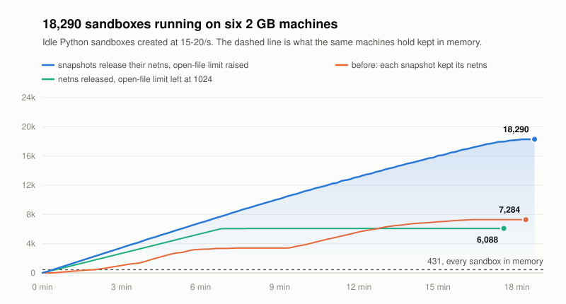
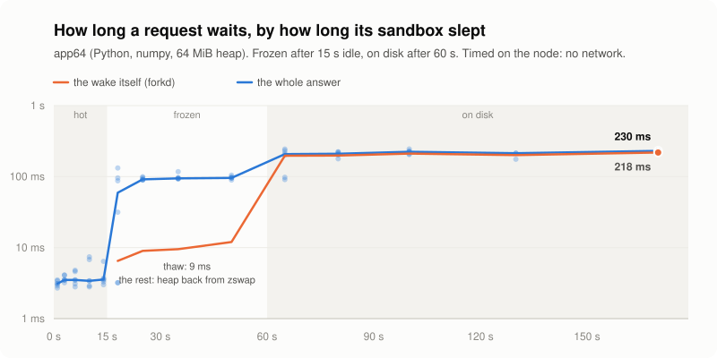
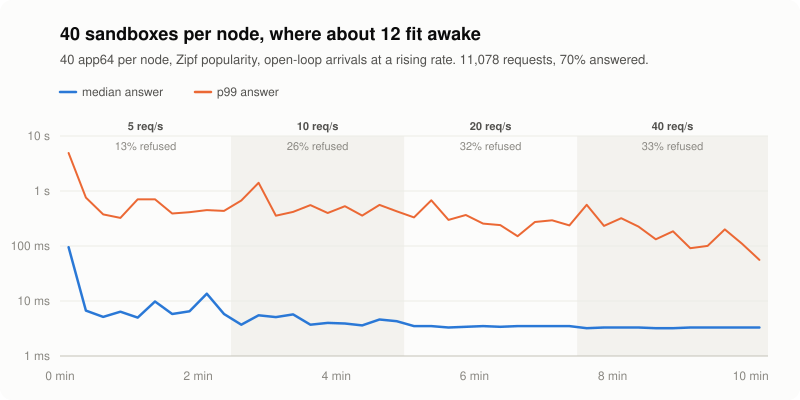
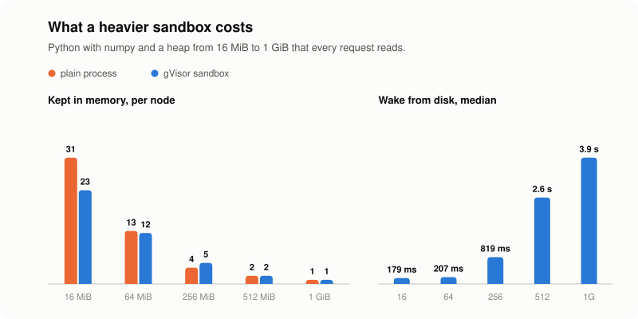

<div align="center">

<picture>
  <source media="(prefers-color-scheme: dark)" srcset="docs/logo-dark.svg">
  
</picture>

</div>

<br/>

<div align="center">

[工作原理](#工作原理) · [实测数据](#实测数据) · [快速开始](#快速开始) · [状态](#状态)

[](https://github.com/deeplethe/sandstorm/actions)
[](LICENSE)
[](https://www.rust-lang.org)
[](https://gvisor.dev)
[](README.md)

</div>

**一个有意超卖的沙箱集群。** agent 的沙箱大部分时间都闲着。sandstorm 先把闲置的沙箱暂停，再把它 checkpoint 到磁盘；请求一到，马上恢复。所以一台机器能装下的沙箱，远多于它能同时跑着的数量。每个沙箱都是一个 [gVisor](https://gvisor.dev) 容器，有自己的网络命名空间。sandstorm 跑在普通云主机上，不需要 KVM，也不需要嵌套虚拟化。

六台 2 核 2 GB 的云主机，全部常驻只能放 **431** 个沙箱，用 sandstorm 跑到了 **18,290** 个。

<div align="center">

<picture>
  <source media="(prefers-color-scheme: dark)" srcset="docs/assets/charts/fleet-running-dark.svg">
  
</picture>

</div>

## 工作原理

每个沙箱处在四个档位之一。闲得越久降得越低，每次降一档；任何请求都让它直接回到 hot。

| 档位 | 状态 | 占内存 | 回到 hot |
|---|---|---|---|
| **hot** | 运行中 | 是 | — |
| **frozen** | 原地暂停（`cgroup.freeze`），冷页被压进 zswap | 部分 | 约 10 ms |
| **snapshot** | checkpoint 到节点本地盘，释放网络命名空间 | 否 | 约 0.2 s |
| **detached** | 只剩它的卷 | 否 | 冷启动 |

- **一个 master，多个节点。** master 把期望状态存在 SQLite 里，决定沙箱放在哪台机器。可以由 master 凭地址和配对码连上节点，也可以由 NAT 后面的节点主动连 master。
- **流量唤醒。** 请求先到沙箱所在节点上的网关，网关把沙箱唤醒，再转发请求。
- **节点会保护自己。** 内存不够时，节点会拒绝新任务，不会把自己撑爆，ssh 也一直能连上。
- **只有一个二进制。** `sandstormd` 既是 master，也是节点，还带 web 面板。

## 一个请求要等多久

在节点本机上测，不经过网络。沙箱是热的时候，3.5 ms 就有响应。冻结的沙箱，解冻只要 10 ms，其余时间主要花在把堆内存从 zswap 读回来。已落盘的沙箱，64 MiB 的堆恢复约 200 ms。

<div align="center">

<picture>
  <source media="(prefers-color-scheme: dark)" srcset="docs/assets/charts/fleet-sleep-dark.svg">
  
</picture>

</div>

## 有流量的时候

每个节点放 40 个沙箱，但只装得下约 12 个同时醒着。请求按真实使用的分布打过去：少数几个沙箱拿走大部分请求。请求的中位数一直保持在热沙箱的 3.4 ms。**撑不住的是长尾：** 唤醒一个沙箱需要内存，节点内存不够时会直接拒绝这次唤醒，而不是先把一个闲着的沙箱落盘腾出位置。每秒 5 个请求时有 13% 被拒绝，每秒 40 个时达到三分之一。

<div align="center">

<picture>
  <source media="(prefers-color-scheme: dark)" srcset="docs/assets/charts/fleet-mixed-dark.svg">
  
</picture>

</div>

## 更重的沙箱

堆内存大的时候，一个沙箱的开销和同一个程序直接作为普通进程跑差不多。堆小的时候，gVisor 自身的开销占大头：一个闲置的 Python，作为普通进程每个节点能放 314 个，作为沙箱只能放 72 个，分档正是用来弥补这个差距的。随堆大小增长的是从磁盘恢复的时间：64 MiB 要 0.2 s，512 MiB 要 2.6 s，1 GiB 要 3.9 s。

<div align="center">

<picture>
  <source media="(prefers-color-scheme: dark)" srcset="docs/assets/charts/fleet-sizes-dark.svg">
  
</picture>

</div>

## 实测数据

六个节点（AMD EPYC，每台 2 vCPU、1.9 GB），一台 master（2 vCPU），runsc `release-20261019.0`，2026-10-26 实测。

| 一个闲置的 Python，每个节点能放 | |
|---|---:|
| 作为普通进程，不进沙箱 | 314 |
| 作为 gVisor 沙箱，全部常驻 | 72 |
| 作为 sandstorm 沙箱，闲置的自动降档 | **3,048** |

| | |
|---|---|
| 创建到第一次响应，64 MiB 的应用 | p50 1.3 s |
| 唤醒：冻结的 / 落盘的，64 MiB 的应用 | 10 ms / 200 ms（sandstorm 自身的时间） |
| 一个节点同时唤醒 10 个 | 10 个全部成功，最慢 2.8 s |
| master 能接收的创建请求 | 约 500 个/秒 |
| master 自身 | 内存 16 MiB，存储锁等待 p99 0.5 ms |

几点说明：为了让测试在几分钟内跑完，空闲计时调短了。测试用的堆是 `numpy.ones`，在 zswap 里压缩得特别好。18,290 不是上限：创建结束时内存还有余量。这个数字依赖 #351 和 #352，这两个 PR 还没合并。测试方法、原始数据和每一轮的结果在 [bench/fleet/results/2026-10-26](bench/fleet/results/2026-10-26/README.md)。

**同一批机器上的其他沙箱。** E2B、CubeSandbox、microsandbox 都基于 Firecracker，需要 KVM，这批云主机没有，所以没法在上面跑。各家的对比见 [docs/COMPARISON.md](docs/COMPARISON.md)。

## 快速开始

需要 Linux 和 cgroup v2，`PATH` 里要有 [`runsc`](https://gvisor.dev/docs/user_guide/install/)，编译需要 Rust。

```bash
git clone https://github.com/deeplethe/sandstorm.git && cd sandstorm
cargo build --release -p sandstorm-core
sudo ./target/release/sandstormd serve --master --node
```

这样会在一个进程里同时跑 master 和节点，面板在 `https://127.0.0.1:8080`，API token 在 `/var/lib/sandstorm/pki/api-token`。沙箱从模板启动，模板是一个 rootfs 加一份 OCI spec，用 `POST /v1/templates` 注册；最小的例子见 `scripts/fleet.sh seed`。

**多台能 ssh 上去的机器组成集群：**

```bash
scripts/fleet.sh up --master m1 --nodes n1,n2,n3 --listen 80
scripts/fleet.sh seed     # 在每个节点放一个模板
scripts/fleet.sh verify   # 启动一个沙箱，确认真的能跑
```

**已经装好的节点**，用 `SANDSTORM_LISTEN=0.0.0.0:80` 监听。第一次启动时它会把配对码写到 `/var/lib/sandstorm/pki/node/pairing-code`。把地址和配对码交给 master：

```bash
curl --cacert ca.pem -H "Authorization: Bearer $SANDSTORM_TOKEN" \
  https://master:8080/v1/nodes -d '{"address": "10.0.0.5", "pairing_code": "<配对码>"}'
```

配对码重启后不变，拿到它就能在那个节点上执行任何操作，请像 root 密码一样保管。

HTTP API 见 [docs/API.md](docs/API.md)。集群压测见 [bench/fleet](bench/fleet/README.md)。

## 状态

v0.6 还没有发布，改动很大：后端从 Firecracker 微虚拟机换成 gVisor，从单机变成集群。最近一次发布是 v0.5.3，那是基于 Firecracker 的 fork 运行时，它的 README 见[那个 tag](https://github.com/deeplethe/sandstorm/tree/v0.5.3)。设计文档在 [DESIGN-v0.6.md](DESIGN-v0.6.md)。

接下来，来自集群实测发现的问题：

- [ ] 唤醒时腾出位置：把最久没用的沙箱落盘，而不是拒绝请求。
- [ ] 节点暂缓的创建，在内存空出来后重试，而不是停放；跑起来后清除它的错误状态。
- [ ] master 在分配时预留容量，避免一波突发请求超过节点上次上报的余量。
- [ ] 同一节点上并行恢复多个 snapshot。

## 许可证

[Apache-2.0](LICENSE)
