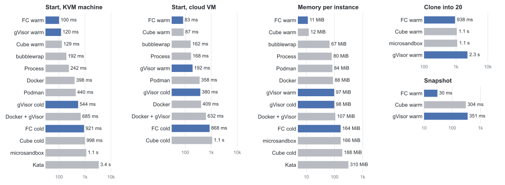
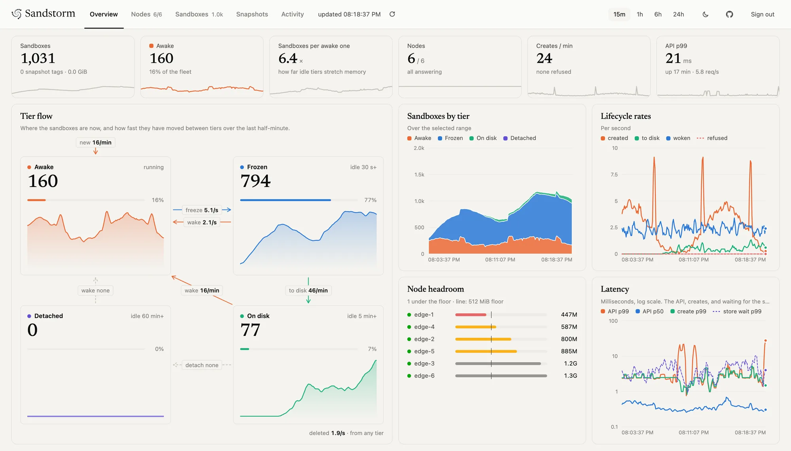

<div align="center">

<picture>
  <source media="(prefers-color-scheme: dark)" srcset="docs/logo-dark.svg">
  
</picture>

</div>

<br/>

<div align="center">

[工作原理](#工作原理) · [延迟](#延迟) · [快速开始](#快速开始) · [状态](#状态)

[](https://github.com/deeplethe/sandstorm/actions)
[](LICENSE)
[](https://www.rust-lang.org)
[](https://deeplethe.com)
[](https://gvisor.dev)
[](https://firecracker-microvm.github.io)
[](README.md)

</div>

**一台机器，万千沙箱。** Sandstorm 通过暂停闲置沙箱并将其快照保存到磁盘，在请求到达时快速恢复，使单台机器能够承载远超其实际并发运行能力的沙箱数量。支持 [gVisor](https://gvisor.dev) 容器和 [Firecracker](https://firecracker-microvm.github.io) microVM 两种沙箱后端。每个沙箱都拥有独立的网络命名空间，不同后端可以在同一集群中运行，并形成各自独立的资源池。主控节点提供 Web 控制台，用于查看和管理沙箱及集群调度。

<div align="center">

<picture>
  <source media="(prefers-color-scheme: dark)" srcset="docs/assets/charts/compare-dark.svg">
  
</picture>

</div>

<sub>FC：Firecracker。Cube：CubeSandbox。云主机：gVisor 和容器用 6 台 2 核 2 GB 节点；Firecracker 和 CubeSandbox 用一台 PVM 下的 2 核 3.6 GB VM。KVM 机器：2 × Xeon E5-2637 v2、31 GB。warm：从应用已启动好的镜像恢复。\* 在节点上启动模板的时间，误差半秒以内：CubeSandbox 没有沙箱的冷启动。克隆指运行中的应用，到 20 份全部响应为止（microsandbox 到运行为止）。</sub>

## 工作原理

每个沙箱处在四个档位之一。闲得越久降得越低，每次降一档；任何请求都让它直接回到 hot。

| 档位 | 状态 | 占内存 | 回到 hot |
|---|---|---|---|
| **hot** | 运行中 | 是 | — |
| **frozen** | 原地暂停（`cgroup.freeze`），冷页被压进 zswap | 部分 | 约 10 ms |
| **snapshot** | checkpoint 到节点本地盘，释放网络命名空间 | 否 | 约 0.2 s |
| **detached** | 只剩它的卷 | 否 | 冷启动 |

- **一个 master，多个节点。** master 把期望状态存在 SQLite 里，决定沙箱放在哪台机器。可以由 master 凭地址和配对码连上节点，也可以由 NAT 后面的节点主动连 master。
- **流量唤醒。** 请求先到沙箱所在节点上的网关，网关把沙箱唤醒，再转发请求。
- **节点会保护自己。** 内存不够时，节点会拒绝新任务，不会把自己撑爆，ssh 也一直能连上。
- **只有一个二进制。** `sandstormd` 既是 master，也是节点，还带 web 面板。

master 在 `/` 提供控制台：每个沙箱在哪一档、在各档之间流动多快、每个节点还剩多少内存。

<p align="center">
<picture>
  <source media="(prefers-color-scheme: dark)" srcset="docs/assets/console-dark.webp">
  
</picture>
</p>

## 延迟

6 台 2 核 2 GB 云主机，gVisor，没有 KVM，2026-10-30。请求从每个节点发给它自己的 gateway，路径上没有网络。

| | |
|---|---:|
| 从冻结唤醒，64 MiB 应用 | 100-170 ms |
| 从磁盘唤醒，16 / 64 / 256 MiB 应用 | 130 / 150 / 750 ms |
| 从磁盘唤醒，512 MiB / 1 GiB 应用 | 1.1 / 3.3 s |
| 每节点常驻内存：web / 64 MiB / 256 MiB 应用 | 50 / 13 / 6 |

流量下，每节点 40 个沙箱（只放得下约 12 个醒着的），少数沙箱拿到大部分请求：每节点每秒 1、2、4、8 个请求时，40,523 个请求里分别有 **1.3%、0.2%、0.1%、1.3%** 被拒绝。p50 是 6-8 ms；p99 约 2 s，是需要等恢复的请求。2 秒内起不来的唤醒会被拒绝，而不是排队：节点同时恢复 2 个、排队 4 个，所以同一瞬间唤醒 10 个或更多时，6 个得到响应，其余立刻返回 503。

## 测试方法

顶部的图：每种运行时一次启动一个，每 5 ms 请求一次，测 20 次取 p50（[`compare.py`](bench/baremetal/compare.py)）。Sandstorm 的时间包括 master 调度和节点建网络。云主机一栏是 6 台 2 核 2 GB 节点的中位数；Firecracker 和 CubeSandbox 是一台 2 核 3.6 GB 的 VM，用 CubeSandbox 的 PVM 内核，让没有 KVM 的 VM 也有 `/dev/kvm`。

预热模板恢复的是应用已经启动好的镜像，CubeSandbox 一直是这样启动的；Sandstorm 这边需要主动开启，因为所有沙箱都从同一份内存开始，模板得说明怎么重新播种随机数。CubeSandbox 没有沙箱的冷启动：它的 cold 数字是启动模板的时间，在节点上测得，和其他行不是同一口径，探针 500 ms 一次，误差在半秒以内。

PVM 上两边的 warm 启动基本持平：web 和 64 MiB 应用，Sandstorm 是 52 / 84 ms，CubeSandbox 是 53 / 87 ms。KVM 机器上 Sandstorm 领先：67 / 100 ms 对 78 / 129 ms。同一台机器、同一个二进制，一天前 64 MiB 应用是 74 ms 和 78 ms，所以这一栏看相对差距。给运行中的沙箱打快照，Sandstorm 要 30 ms，CubeSandbox 要 304 ms。克隆成 1、10、20 份，Sandstorm 是 138、507、938 ms，CubeSandbox 是 494、1,046、1,064 ms；Sandstorm 在节点上逐个创建，每个约 45 ms，CubeSandbox 是同时创建，所以 n 更大时差距会缩小。E2B 自托管没有搭，PVM 上的内存没有测。原始数据见 [bench/baremetal/results/2026-10-30](bench/baremetal/results/2026-10-30/README.md)、[bench/fleet/results/2026-10-30](bench/fleet/results/2026-10-30/README.md)。

## 快速开始

需要 Linux 和 cgroup v2，`PATH` 里要有 [`runsc`](https://gvisor.dev/docs/user_guide/install/)，编译需要 Rust。

```bash
git clone https://github.com/deeplethe/sandstorm.git && cd sandstorm
cargo build --release -p sandstorm-core
sudo ./target/release/sandstormd serve --master --node
```

这样会在一个进程里同时跑 master 和节点，面板在 `https://127.0.0.1:8080`，API token 在 `/var/lib/sandstorm/pki/api-token`。沙箱从模板启动，模板是一个 rootfs 加一份 OCI spec，用 `POST /v1/templates` 注册；最小的例子见 `scripts/fleet.sh seed`。

**多台能 ssh 上去的机器组成集群：**

```bash
scripts/fleet.sh up --master m1 --nodes n1,n2,n3 --listen 80
scripts/fleet.sh seed     # 在每个节点放一个模板
scripts/fleet.sh verify   # 启动一个沙箱，确认真的能跑
```

**已经装好的节点**，用 `SANDSTORM_LISTEN=0.0.0.0:80` 监听。第一次启动时它会把配对码写到 `/var/lib/sandstorm/pki/node/pairing-code`。把地址和配对码交给 master，CA 和 API token 用 master 上 `/var/lib/sandstorm/pki` 里的那两个文件：

```bash
curl --cacert ca.pem -H "Authorization: Bearer $(cat api-token)" -H 'Content-Type: application/json' \
  https://master:8080/v1/nodes -d '{"address": "10.0.0.5", "pairing_code": "<配对码>"}'
```

配对码重启后不变，拿到它就能在那个节点上执行任何操作，请像 root 密码一样保管。

HTTP API 见 [docs/API.md](docs/API.md)。集群压测见 [bench/fleet](bench/fleet/README.md)。

## 状态

v0.6 还没有发布，改动很大：后端从 Firecracker 微虚拟机换成 gVisor，从单机变成集群。最近一次发布是 v0.5.3，那是基于 Firecracker 的 fork 运行时，它的 README 见[那个 tag](https://github.com/deeplethe/sandstorm/tree/v0.5.3)。架构决策记录在 [docs/adr](docs/adr/README.md)（英文）。

接下来，来自集群实测发现的问题：

- [x] 唤醒时腾出位置：把最少被用到的沙箱落盘，而不是拒绝请求。
- [x] 节点暂缓的创建，在内存空出来后重试，而不是停放；跑起来后清除它的错误状态。
- [x] 清理死掉的沙箱，连同它的网络；如果还需要它，就重新启动。
- [ ] master 在分配时预留容量，避免一波突发请求超过节点上次上报的余量。
- [ ] 同一节点上并行恢复多个 snapshot。

## 许可证

[Apache-2.0](LICENSE)
