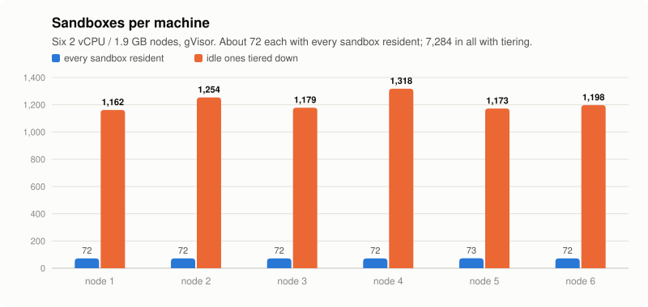
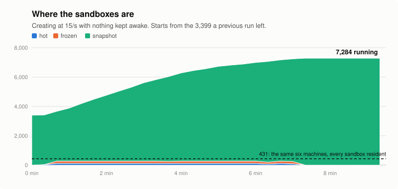

<div align="center">

<picture>
  <source media="(prefers-color-scheme: dark)" srcset="docs/logo-dark.svg">
  
</picture>

</div>

<br/>

<div align="center">

[How it works](#how-it-works) · [Numbers](#numbers) · [Quick start](#quick-start) · [Status](#status)

[](https://github.com/deeplethe/forkd/actions)
[](LICENSE)
[](https://www.rust-lang.org)
[](https://gvisor.dev)
[](README-zh.md)

</div>

**A sandbox fleet that is oversold on purpose.** Most agent sandboxes sit idle most of the time. forkd pauses an idle sandbox, then checkpoints it to disk, and brings it back the moment a request reaches it. So a machine holds far more sandboxes than it could keep running. Every sandbox is a [gVisor](https://gvisor.dev) container with its own network namespace.

On six 2 GB cloud machines that fit **431** sandboxes kept resident, forkd ran **7,284**.

<div align="center">

<picture>
  <source media="(prefers-color-scheme: dark)" srcset="docs/assets/charts/fleet-per-node-dark.svg">
  
</picture>

<picture>
  <source media="(prefers-color-scheme: dark)" srcset="docs/assets/charts/fleet-tiers-dark.svg">
  
</picture>

</div>

## How it works

Every sandbox is in one of four tiers. It drops a tier at a time as it stays idle, and any request takes it straight back to hot.

| Tier | Where it is | Holds memory | Back to hot |
|---|---|---|---|
| **hot** | running | yes | — |
| **frozen** | paused in place (`cgroup.freeze`) | yes | ~10 ms |
| **snapshot** | checkpointed to the node's disk | no | ~0.2 s |
| **detached** | only its volume is left | no | cold start |

- **One master, many nodes.** The master keeps desired state in SQLite and decides placement. Each node runs the sandboxes and reports back. Either the master connects to a node by address and pairing code, or a node behind NAT dials the master.
- **Nodes protect themselves.** A node short on memory or under memory pressure turns away new work instead of running out of memory, and it still answers ssh.
- **Wake on traffic.** A request to a frozen or snapshotted sandbox's port wakes it.
- **One binary.** `forkd-serve` is the master, the node and the web panel.

## Numbers

Measured on 2026-10-26: six nodes (AMD EPYC, 2 vCPU, 1.9 GB each) and one master (2 vCPU), runsc `release-20261019.0`.

| | |
|---|---|
| Sandboxes, every one resident | **431** (about 72 per node) |
| Sandboxes with idle ones tiered down | **7,284** running, 0 failed to start |
| Create to first exec, cold | p50 **0.24 s** |
| Wake from snapshot | p50 **0.19 s** |
| 300 snapshots woken at once | 300 of 300 in **7.3 s** |
| Create requests the master accepts | **~500/s** |
| Creates the fleet sustains | **15–20/s**; above that, nodes start holding work back |
| Master | 16 MiB RSS, store lock p99 0.5 ms |

The test sandbox is a sleeping Python process, about 14 MiB resident. The idle timers were shortened so the test would fit in minutes. Each node had a 2 GB swap file on disk, with zswap off.

The 7,284 ceiling is not sandbox memory. A snapshotted sandbox keeps its network namespace, about 0.4 MiB of kernel memory each, and that is what ran out. The raw data, the method and the full set of runs are in [bench/fleet/results/2026-10-26](bench/fleet/results/2026-10-26/README.md).

## Quick start

You need Linux with cgroup v2, [`runsc`](https://gvisor.dev/docs/user_guide/install/) on the `PATH`, and Rust to build.

```bash
git clone https://github.com/deeplethe/forkd.git && cd forkd
cargo build --release -p forkd-core
sudo ./target/release/forkd-serve serve --master --node
```

That runs a master and a node in one process, with the panel at `https://127.0.0.1:8080`. The API token is in `/var/lib/forkd/pki/api-token`. A sandbox starts from a template, a rootfs plus an OCI spec registered with `POST /v1/templates`; `scripts/fleet.sh seed` shows the smallest one.

**A fleet** of machines you can ssh to:

```bash
scripts/fleet.sh up --master m1 --nodes n1,n2,n3 --listen 80
scripts/fleet.sh seed     # put a template on each node
scripts/fleet.sh verify   # start one sandbox and check it runs
```

**A node that is already installed** listens with `FORKD_LISTEN=0.0.0.0:80`. On first start it writes a pairing code to `/var/lib/forkd/pki/node/pairing-code`. Give the master its address and that code:

```bash
curl --cacert ca.pem -H "Authorization: Bearer $FORKD_TOKEN" \
  https://master:8080/v1/nodes -d '{"address": "10.0.0.5", "pairing_code": "<code>"}'
```

The code stays the same across restarts, and whoever holds it can run anything on that node. Keep it like a root password.

The HTTP API is documented in [docs/API.md](docs/API.md). To load-test a fleet, use [bench/fleet](bench/fleet/README.md).

## Status

v0.6 is not released yet, and it changes a lot: the backend moves from Firecracker microVMs to gVisor, and one host becomes a fleet. The last release, v0.5.3, is the Firecracker fork runtime; its README is [at that tag](https://github.com/deeplethe/forkd/tree/v0.5.3). The design is in [DESIGN-v0.6.md](DESIGN-v0.6.md) (Chinese).

Next:

- [ ] Release a snapshotted sandbox's network namespace, and rebuild it on wake. This is what limits density today.
- [ ] Reserve capacity on the master as it places, so a burst cannot overshoot a node's last report.
- [ ] Restore several snapshots in parallel on one node.

## License

[Apache-2.0](LICENSE)
