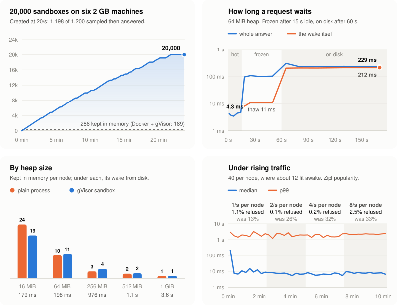
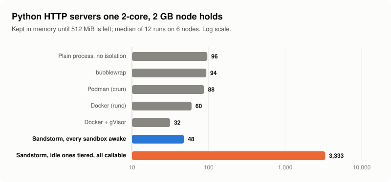

<div align="center">

<picture>
  <source media="(prefers-color-scheme: dark)" srcset="docs/logo-dark.svg">
  
</picture>

</div>

<br/>

<div align="center">

[How it works](#how-it-works) · [Numbers](#numbers) · [Quick start](#quick-start) · [Status](#status)

[](https://github.com/deeplethe/sandstorm/actions)
[](LICENSE)
[](https://www.rust-lang.org)
[](https://deeplethe.com)
[](https://gvisor.dev)
[](README-zh.md)

</div>

**A sandbox fleet that is oversold on purpose.** Most agent sandboxes sit idle most of the time. Sandstorm pauses an idle sandbox, then checkpoints it to disk, and brings it back the moment a request reaches it. So a machine holds far more sandboxes than it could keep running. Every sandbox is a [gVisor](https://gvisor.dev) container with its own network namespace, and Sandstorm runs on ordinary cloud VMs: no KVM, no nested virtualisation.

On six cloud machines with 2 cores and 2 GB each, which hold **286** Python HTTP servers kept in memory, Sandstorm held **20,000** — and of 1,200 picked at random afterwards and called, 1,198 answered.

<div align="center">

<picture>
  <source media="(prefers-color-scheme: dark)" srcset="docs/assets/charts/fleet-overview-dark.svg">
  
</picture>

</div>

## How it works

Every sandbox is in one of four tiers. It drops a tier at a time as it stays idle, and any request takes it straight back to hot.

| Tier | Where it is | Holds memory | Back to hot |
|---|---|---|---|
| **hot** | running | yes | — |
| **frozen** | paused in place (`cgroup.freeze`); its cold pages squeezed into zswap | some | ~10 ms |
| **snapshot** | checkpointed to the node's disk; its network namespace released | no | ~0.2 s |
| **detached** | only its volume is left | no | cold start |

- **One master, many nodes.** The master keeps desired state in SQLite and decides placement. The master connects to a node by address and pairing code, or a node behind NAT dials the master.
- **Wake on traffic.** A request to a sandbox's port reaches a gateway on its node, which wakes the sandbox and then forwards the request.
- **Nodes protect themselves.** A node short on memory turns work away instead of running out, and still answers ssh.
- **One binary.** `sandstormd` is the master, the node and the web console.

## Latency and cost

The four smaller panels in the figure at the top, in order:

- **Waking.** Timed on the node, so no network is in the path. A hot sandbox answers in 3.8 ms. Frozen, the thaw takes 11 ms and reading its heap back from zswap takes most of the rest: about 100 ms. On disk, the restore is about 230 ms for a 64 MiB heap.
- **Under traffic.** 40 sandboxes per node, where about 12 fit awake, with a few of them getting most requests. A wake that finds the node out of memory puts the sandboxes least in demand to disk to make room, and one that cannot start within 2 s is refused rather than queued, so at 1, 2, 4 and 8 requests a second per node **1.1%, 0.1%, 0.2% and 2.5%** of requests were refused, against 13%, 26%, 32% and 33% before (three runs, 40,500 requests). The cost is in the tail: a request that has to wait for a restore takes about 2 s at p99, at every rate. Past what a node can turn over — 80 per node at 8 req/s — it refuses 10.6%, with a p99 of 3.2 s.
- **Heavier sandboxes.** With a large heap, a sandbox costs about what the same program does as a plain process: 13 against 11 per node at 64 MiB, 6 against 4 at 256 MiB, because the node squeezes idle pages into zswap and the test heap compresses well. With a small one, gVisor's own overhead dominates, which is what tiering makes up for. Waking from disk grows with the heap: 0.2 s at 64 MiB, 1 s at 256 and 512 MiB, 3.6 s at 1 GiB.

## Against the same machines without Sandstorm

<div align="center">

<picture>
  <source media="(prefers-color-scheme: dark)" srcset="docs/assets/charts/fleet-compare-dark.svg">
  
</picture>

</div>

The same Python HTTP server on the same six nodes, each runtime kept in memory until 512 MiB is left, twice on every node ([`baselines.py`](bench/fleet/baselines.py)). Sandstorm with every sandbox awake holds half again as many as Docker with gVisor, the same isolation, because it runs no daemon and no shim per container; with idle ones tiered it holds two orders of magnitude more than anything that keeps them in memory.

| Per node, 2 vCPU, 1.9 GB | HTTP server kept in memory | 64 MiB heap |
|---|---:|---:|
| plain process | 96 | 11 |
| bubblewrap | 94 | 11 |
| Podman (crun) | 88 | 12 |
| Docker (runc) | 60 | 10 |
| Docker + gVisor | 32 | 9 |
| **Sandstorm, all awake** | **48** | **13** |
| **Sandstorm, idle ones tiered** | **3,333** | |

Starting, timed on one machine (bm: AMD EPYC 9K65, 2 vCPU, 3.6 GB; dev at 872682b) the way the baselines are: one at a time, polled every 50 ms until it answers ([`starttime.py`](bench/fleet/starttime.py)). Sandstorm's time includes the master placing the sandbox and the node setting up its network.

| Start to first answer, p50 | web | 64 MiB app |
|---|---:|---:|
| plain process | 52 ms | 103 ms |
| bubblewrap | 52 ms | 103 ms |
| Docker (runc) | 192 ms | 244 ms |
| Docker + gVisor | 217 ms | 333 ms |
| **Sandstorm** | **167 ms** | **289 ms** |
| **Sandstorm, warm template** | **159 ms** | **168 ms** |

Of Sandstorm's 289 ms for the 64 MiB app, 37 ms is the master and the network, 5 ms the bundle, 55 ms runsc and 189 ms Python importing numpy and filling its heap. A warm template restores an image of the app already started, so it skips that last part; it is opt-in, because every sandbox starts from the same memory and the template has to say how to reseed. The 50 ms poll is the floor.

Checkpoint and restore with CRIU under Podman, the nearest standard counterpart to the snapshot tier, takes 0.3 s to checkpoint a 64 MiB app and 0.24 s from restore to first answer; Sandstorm restores the same app in 0.2 s. E2B, CubeSandbox and microsandbox are built on Firecracker and need KVM, which these VMs do not have, so they could not be run here; [docs/COMPARISON.md](docs/COMPARISON.md) covers the field.

## Numbers

Six nodes (AMD EPYC, 2 vCPU, 1.9 GB each) and one master (2 vCPU), runsc `release-20261019.0`, on 2026-10-28.

| | |
|---|---|
| 20,000 Python HTTP servers at 20/s | all 20,000 up with nothing retried by hand, twice |
| 100 of them per node, picked at random, called | 1,198 of 1,200 answered; p50 1.3 s, p99 2.8–5.5 s |
| Wake: frozen / from disk, 64 MiB app | 11 ms / 200 ms (Sandstorm's own time) |
| Wake 20 / 40 at once on one node | all of them; slowest 6 s / 13 s |
| Create to first answer, 64 MiB app | p50 1.4 s with five starting at once on a node, polled every 0.25 s; 0.29 s one at a time (above) |

Some caveats. The idle timers were shortened so a run fits in minutes. The test heap is `numpy.ones`, which compresses unusually well in zswap. 20,000 is where the fill stopped, not a ceiling. Method, raw data, every run, and the bugs the runs turned up are in [bench/fleet/results/2026-10-28](bench/fleet/results/2026-10-28/README.md); the earlier round is [2026-10-26](bench/fleet/results/2026-10-26/README.md).

## Quick start

You need Linux with cgroup v2, [`runsc`](https://gvisor.dev/docs/user_guide/install/) on the `PATH`, and Rust to build.

```bash
git clone https://github.com/deeplethe/sandstorm.git && cd sandstorm
cargo build --release -p sandstorm-core
sudo ./target/release/sandstormd serve --master --node
```

That runs a master and a node in one process, with the console at `https://127.0.0.1:8080`. The API token is in `/var/lib/sandstorm/pki/api-token`. A sandbox starts from a template, a rootfs plus an OCI spec registered with `POST /v1/templates`; `scripts/fleet.sh seed` shows the smallest one.

**A fleet** of machines you can ssh to:

```bash
scripts/fleet.sh up --master m1 --nodes n1,n2,n3 --listen 80
scripts/fleet.sh seed     # put a template on each node
scripts/fleet.sh verify   # start one sandbox and check it runs
```

**A node that is already installed** listens with `SANDSTORM_LISTEN=0.0.0.0:80`. On first start it writes a pairing code to `/var/lib/sandstorm/pki/node/pairing-code`. Give the master its address and that code:

```bash
curl --cacert ca.pem -H "Authorization: Bearer $SANDSTORM_TOKEN" \
  https://master:8080/v1/nodes -d '{"address": "10.0.0.5", "pairing_code": "<code>"}'
```

The code stays the same across restarts, and whoever holds it can run anything on that node. Keep it like a root password.

The HTTP API is documented in [docs/API.md](docs/API.md). To load-test a fleet, use [bench/fleet](bench/fleet/README.md).

## Status

v0.6 is not released yet, and it changes a lot: the backend moves from Firecracker microVMs to gVisor, and one host becomes a fleet. The last release, v0.5.3, is the Firecracker fork runtime; its README is [at that tag](https://github.com/deeplethe/sandstorm/tree/v0.5.3). The design decisions are recorded in [docs/adr](docs/adr/README.md).

Next, from what the fleet runs found:

- [x] Make room on wake: put the sandbox least in demand to disk instead of refusing the request.
- [x] Retry a create the node held back once memory frees, instead of parking it; and clear its error once it runs.
- [x] Clear away a sandbox that dies, network included, and restart it if it is still wanted.
- [ ] Reserve capacity on the master as it places, so a burst cannot overshoot a node's last report.
- [ ] Restore several snapshots in parallel on one node.

## License

[Apache-2.0](LICENSE)
