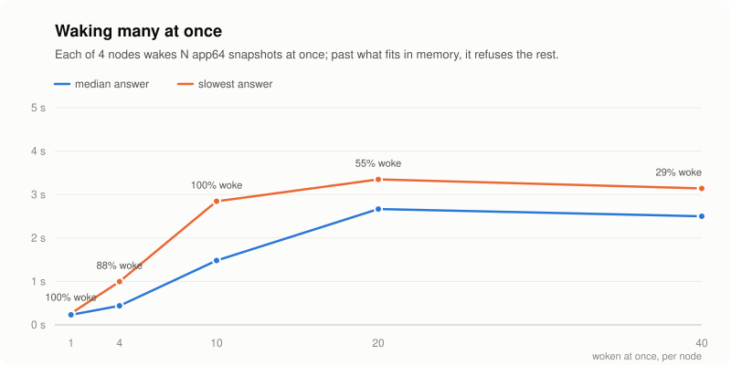

# Fleet run, 2026-10-26

Seven cloud machines, one afternoon. The numbers on the front page come
from here.

## Setup

| | |
|---|---|
| Master | 1 × Intel Xeon Gold 6148, 2 vCPU, 1.9 GB |
| Nodes | 6 × AMD EPYC 7K62, 2 vCPU, 1.9 GB, kernel 7.0.0-14 |
| Runtime | runsc `release-20261019.0` |
| Build | `dev` with #347 (the master connects to nodes on :80), before #348 (frozen reclaim, snapshot compression) |
| Template | `py` from `scripts/fleet.sh seed`: a sleeping Python process, host `/usr` bound read-only, 128 MiB limit, about 14 MiB resident |
| Swap | a 2 GB file on disk on every node, zswap off |
| Admission | defaults: 512 MiB free floor, memory PSI 8.0 |
| Idle timers | shortened so a run fits in minutes: frozen after 10 s and snapshot after 40 s in round 1, 5 s and 15 s in round 2 (defaults are 30 s and 5 min) |

All runs drive the master's HTTP API with [`loadtest.py`](../../loadtest.py).
`raw/` has each run's report. `running.csv` is the running count through
`x1` and `x2` back to back, which the README's chart is drawn from
(`python3 bench/fleet/charts.py bench/fleet/results/2026-10-26 docs/assets/charts`).
`per_node.csv` is where the 7,284 sat at the end of `x2`.

## Results

| Run | What | Result |
|---|---|---|
| `t1_c*` | 200 creates at concurrency 1, 4, 16, 64 | 396, 508, 482, 444 accepted/s. Store lock wait p99 0.5 ms throughout |
| `t2_wall` | create with `--touch` until refused: every sandbox resident | 433 placed, 431 running, 72–73 per node |
| `t3_overcommit` | 1,800 at 3/s, left idle | 1,800 running, 0 refused, 0 failed, all in snapshot |
| `x1_r*` | sustained create rate, 5 → 40/s | 5/s and 10/s clean. 20/s: 252 of 1,776 held back by nodes. 40/s: nodes pinned at the free-memory floor, 2,288 held back |
| `x2_total` | 6,000 at 15/s, through refusals | **7,284 running** across the six nodes (1,162–1,318 each), 0 failed after the held-back ones were retried |
| `t5_cold` | create → first exec, one at a time | p50 0.24 s, max 0.27 s |
| `t4_restore` | snapshot → hot, one at a time | p50 0.19 s |
| `x3_herd_clean_300` | wake 300 snapshots at once | 300 of 300 in 7.26 s, p50 4.45 s, p99 6.24 s. Restores run one at a time per node, about 7/s each |
| `x4_abuse` | 3,000 creates as fast as possible | master accepted all 3,000 (420/s). Nodes started 406 and held the rest back. 42 ssh probes during the run, 0 failed |

## What limits it

**Memory per resident sandbox.** About 14 MiB each, most of it the gVisor
sentry rather than the app. At the 512 MiB floor that is the 72 per node in
`t2_wall`.

**Kernel memory per snapshotted sandbox.** A snapshotted sandbox frees its
process memory but keeps its network namespace and veth: about 0.4 MiB of
kernel slab each. One node at 1,538 sandboxes had 694 MiB of slab. That is
the 7,284 ceiling. Disk was not close: each snapshot is about 3.2 MiB.

**Create rate.** The master accepts about 500 creates a second, but a node
starts one sandbox at a time. Above 15–20 creates a second across six nodes,
the free-memory figure each node last reported is stale by the time the
placements land, and nodes hold work back instead. They stay responsive while
they do it, which is what `x4_abuse` checks.

**Burst wakes.** One restore at a time per node. 300 at once across six nodes
takes about 7 s.

---

# Round 3: real requests, heavier apps, the new ceiling

Same six nodes and master, later the same day.

| | |
|---|---|
| Build | `dev` with #350 (hot reclaim, warm templates, prefetch, zswap bootstrap) and #351 (snapshots release their netns) merged locally, commit `983df8b`. Nodes turned zswap on in front of the 2 GB disk swap themselves |
| Templates | `idle` as before, and `app16` … `app1024`: Python with numpy and a heap of that many MiB, serving HTTP, where every request reads one value from every page of the heap (`r3/scripts/srv.py`; the driver is [`workloads.py`](../../workloads.py), and `r3/scripts` has the scripts each machine ran) |
| Idle timers | frozen after 15 s, snapshot after 60 s; 5 s and 15 s for the ceiling runs |
| Where requests come from | each node, over loopback, to its own gateway. The cloud firewall only opened 22 and 80 between machines, and the gateway ports start at 20000. So no network is in any latency here |

`r3/` holds every run's events. `running-r3a.csv` and `running-r3b.csv` are rebuilt from the nodes' own logs, the first time each sandbox reported `running`, because the master's view lags (see the last bug below).

## Results

| Run | What | Result |
|---|---|---|
| `ceiling` (r3a) | idle, 14,000 at 15/s | **6,088** running. Every node stopped near 1,000: `ip netns add` failed with *No file descriptors available*. The node's soft open-file limit was 1024 |
| `ceiling2` (r3b) | idle, 20,000 at 20/s, `LimitNOFILE=524288` on the node units | **18,290** running and on disk, 3,048 per node. The master refused 1,584 when every node's last report was under its memory floor. Afterwards a node with 2,100 snapshots had 1,342 MiB free: the limit was the create rate, not a per-sandbox cost |
| `sleep` | 84 app64, each touched once and then left for 1 to 170 s | hot 3.5 ms; frozen 95 ms of which 10 ms is the thaw; on disk 213 ms of which 203 ms is the restore |
| `sizes` + `heavy` | 5 per node of app16/64/256, 2 of app512, 1 of app1024, checkpointed and then requested | restore p50: 179 ms, 207 ms, 819 ms, 2.6 s, 3.9 s. Create to first answer p50: 1.4 s, 1.3 s, 1.7 s, 8.7 s, 56 s |
| `wall_app*` | create with `--touch` until the nodes push back | per node: app16 23, app64 12.5, app256 5 |
| `bare` | the same programs as plain processes, started until MemAvailable fell under 512 MiB | per node: idle 314, app16 31, app64 13, app256 4, app512 2, app1024 1 |
| `herd` | each node wakes N app64 snapshots at once, N = 1 … 40 (4 nodes) | up to 10: all wake, slowest 2.8 s. At 20 and 40: about 11 wake, the rest are refused, since 11 is what fits in memory |
| `mixed` | 40 app64 per node (5 nodes), Zipf 1.1 popularity, open-loop arrivals at 5, 10, 20, 40 req/s fleet-wide, 150 s each | 11,078 requests; answered p50 3.4 ms, p99 415 ms; refused 13%, 26%, 32%, 33% by phase |

<picture>
  <source media="(prefers-color-scheme: dark)" srcset="../../../../docs/assets/charts/fleet-herd-dark.svg">
  
</picture>

Caveats: the heap is `numpy.ones`, which compresses far better in zswap than a real heap. That is why app256 fits 5 per node as sandboxes and only 4 as plain processes. `mixed` ran on five nodes: on f10 the population never completed. `herd` has results from four nodes: f5 and f10 were stuck behind the parked-create bug below.

## Bugs it found

1. **The open-file limit.** Fixed in #352: the daemon raises its soft limit, and the units set `LimitNOFILE`.
2. **Waking refuses instead of making room.** A wake needs memory. A node with none to spare answers 503 rather than checkpointing its least recently used sandbox. This is the 13–33% in `mixed`.
3. **A held-back create can be parked for good.** A create the node holds back for memory is retried with backoff. After a few attempts it is quarantined and is not retried when memory frees. Meanwhile the idle policy can demote it before it ever ran. The driver works around this by touching and `POST /retry`-ing while it waits.
4. **The error outlives the failure.** A sandbox that was held back and then started still carries `last_error` on the master. So `loadtest.py` reported 5,836 of `ceiling2` as failed to start, when the nodes' logs show every one of them running and checkpointed.
5. **A crashed sandbox cannot restart, and leaves its network behind.** If the process inside exits, the re-create fails with *container already exists* forever. Deleting it leaves its netns, and the next sandbox given the same address is unreachable. Found when numpy could not load because `/etc/alternatives` is not in the template rootfs.

---

# Cross-machine restore, between identical nodes

Whether a fork can land on another node depends on whether a runsc checkpoint restores on a different machine with the same fingerprint. DESIGN-v0.6.md says it SIGSEGV'd there, but the evidence §15 records is from machines whose fingerprints differ. So this was tested directly with plain runsc, no forkd, before the machines were returned.

- **Machines:** f3, f5 and f7, which matched on runsc `release-20261019.0`, kernel 7.0.0-14, AMD EPYC 7K62, CPU flags and microcode `0x1000065`.
- **Sandbox:** Python holding a 128 MiB random numpy heap with a known SHA-256. It re-hashes the heap every three seconds and does a BLAS dot product every beat (`cross-node/app.py`).
- **Procedure:** checkpoint on one machine, send the 143 MB image to another over port 80, restore it there, and check that the heartbeat carries on and the heap hash still matches (`cross-node/xr.sh`).

| Trial | Result |
|---|---|
| control: f3 → f3 | ok |
| f3 → f5, twice | ok, heap matches |
| f5 → f3, twice | ok, heap matches |
| f3 → f7 | ok, heap matches |
| a second hop: f3 → f5 → f7 | ok, heap matches |
| fork: one image restored on f3, f5 and f7 at once | all three ok, heap matches |

**Numbers.** Checkpoint took 0.09–0.11 s; sending 143 MB took 0.4–0.6 s; restore took 0.11–0.16 s.

**Afterwards.** Every restored sandbox was still running minutes later. The runsc debug logs on all three machines had no SIGSEGV, panic or fatal error.

So between nodes with an identical fingerprint, a checkpoint restores, and one image can seed children on several nodes. That is what a pool promises. The SIGSEGV claim did not reproduce here; whatever produced it was something the fingerprint does not cover, or is gone in this runsc release.
